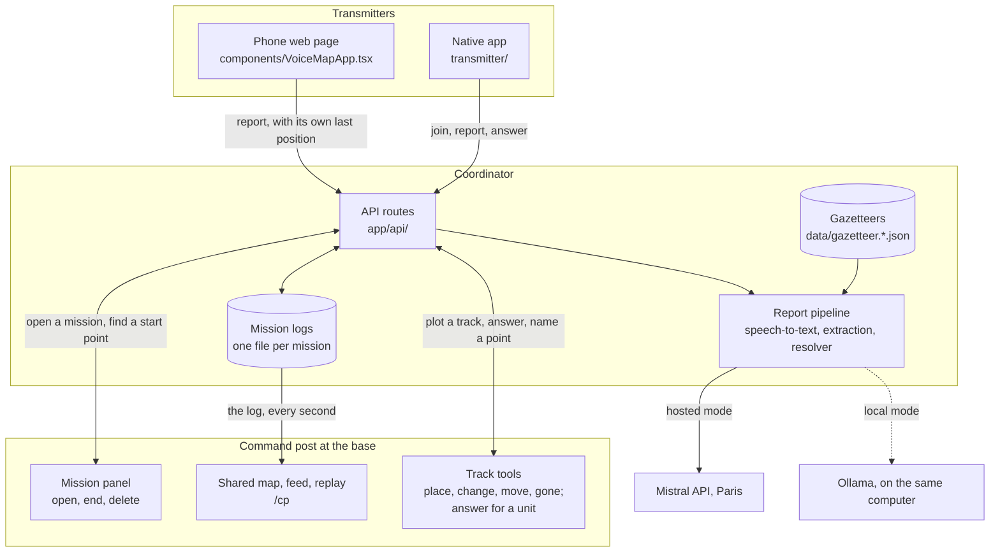
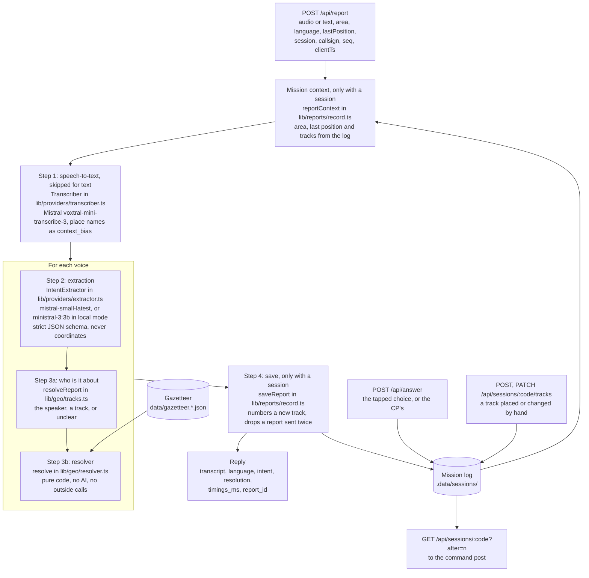
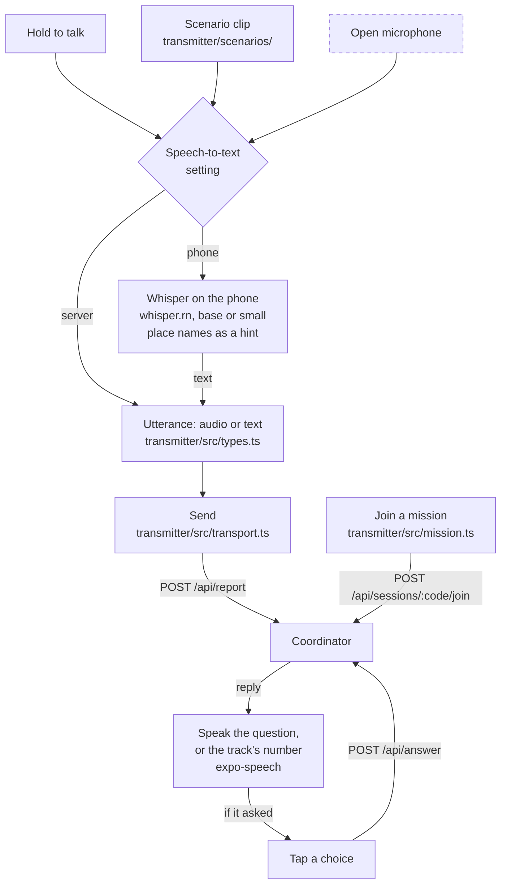
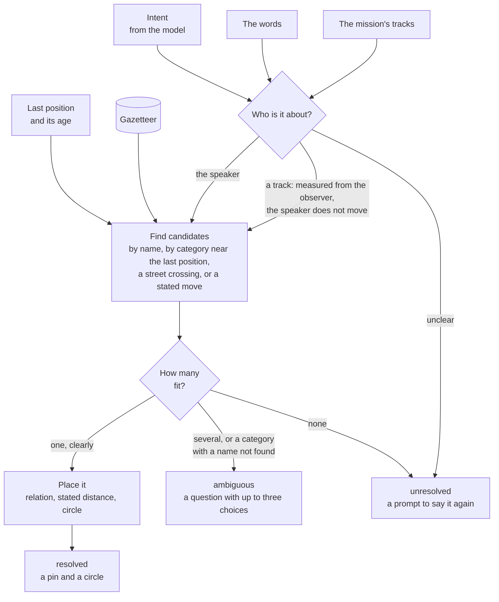

# Architecture

One speaker's path works end to end on the live site, in two areas and three languages. The shared command post works on a coordinator that runs on a computer; the live site does not keep reports yet. Local mode and the evaluation harness are not finished. Status as of Friday 20 November, evening.

## The parts

- **Transmitter**: anything that captures a spoken report. Today that is the phone web page and a native app in `transmitter/`. Lysk's real users may well use radios; the coordinator does not care where a report comes from [58].
- **Coordinator**: the server endpoint `POST /api/report`. Speech-to-text, then intent extraction, then the resolver. It keeps missions: each report in a mission goes to that mission's log, and the unit's last position comes from that log [99, 107, 108].
- **Command post (CP)**: the shared map at the base station, with every call sign, the tracks and a replay. `/cp`, called the receiver before 21 Nov [175]. It opens and ends missions, places and edits tracks by hand, and can answer a unit's open question [98, 113, 176, 177]. It never places a unit.
- **Mission**: one run, with a code, an area and an optional start point. Phones join it before they report [107, 114].
- **Track**: something on the map that is not a reporting unit. A unit sees it and reports it by voice; the coordinator numbers it and the command post draws it with its standard symbol. For reconnaissance only [145 to 152].
- **Area**: a region with its own gazetteer file (`vincennes`, `kyiv`, and since 21 November `izium`). All three are on the live site.

## Block diagrams

Drawn from the code on Saturday 21 November. In these diagrams a dashed box or line is optional or not built yet; the text under each diagram says which. The contracts on each line are in [contracts.md](contracts.md).

### The blocks

The coordinator is one Next.js app, on Vercel in Paris or on the Mac. The dashed line is local mode, `PROVIDER_MODE=local`, which has no speech-to-text on the computer yet [83]. The web page joins no mission, so its reports are not saved. The live site keeps no mission logs at all [101]. Both maps load their tiles, fonts and icons from OpenFreeMap.

### A report through the coordinator

Each box names the function or interface that does the step. Steps 2 and 3 run once for each voice in the clip that names a place, which is nearly always one; `readVoices` in `lib/geo/voices.ts` splits them, and two voices that name different places give a question [154]. See [voices.md](voices.md).

### Inside the transmitter

The open microphone is not built ([plan](plan.md#transmitter)). Every source ends in the same utterance and the same send path, so a scenario clip goes the way a recording does [60, 61]. The transmitter has no map; the command post shows it.

## Where each step runs

| Step | Where |
|---|---|
| Recording | On the phone |
| Speech-to-text | Mistral's API, called from our server in Paris; or on the phone, in the native app [71 to 74] |
| Intent extraction | Mistral's API, same route; or Ollama on the same computer in local mode [83] |
| Resolving the place | Our server; plain code, no AI, no outside calls |
| Map | On the phone; tiles, fonts and icons from OpenFreeMap |
| Speaking the question | In the language the phone is set to [106]. The browser's voice for English and French; for Ukrainian, a Piper voice that runs in the browser [49] |
| State (position history) | In a mission, in the mission's log on the coordinator, which the resolver and the command post both read [108]. With no mission, on the phone, which sends its last position with each report |
| Shared map and replay | The command post page, rebuilt from the session log in the browser [98] |

## What is built

| Part | Where | Status |
|---|---|---|
| Phone web page: hold to talk, map, pin with confidence circle, ask-back card, log, text box | `app/page.tsx`, `components/VoiceMapApp.tsx` | Live. Checked in a phone-sized desktop browser; no real-phone result is recorded yet. |
| Report endpoint | `app/api/report/route.ts` | Live |
| Speech-to-text and extraction | `lib/providers/transcriber.ts`, `lib/providers/extractor.ts` | Mistral, or extraction through Ollama on the computer with `PROVIDER_MODE=local`; behind interfaces |
| Resolver | `lib/geo/resolver.ts` | Pure function, unit-tested (`npm test`) |
| Gazetteers | `data/gazetteer.vincennes.json` (1,130 places), rebuilt 21 November; `data/gazetteer.kyiv.json` (2,840), rebuilt 20 November; `data/gazetteer.izium.json` (714), built Saturday 21 November | Built with `npm run gazetteer -- <area>`; the running app never calls Overpass. See [gazetteer.md](gazetteer.md). Izium is a town near the front in Kharkiv Oblast; its 9 demo reports were typed into the coordinator with hosted Mistral, 9 of 9. Not spoken yet. |
| Ukrainian voice for questions | `lib/tts/`, test page at `/tts-lab` | Live. Piper `uk_UA-ukrainian_tts-medium`, speaker tetiana, through onnxruntime-web in a worker, so the page keeps responding [105]. 77 MB on first load, with nothing on screen to show it. Phones unmeasured. |
| Stated distances, eight compass points, dead reckoning | resolver and extractor | Live since the deploy of 21 November |
| Native transmitter (Expo 58, React Native) | `transmitter/` | iPhone 13 mini through the Mac coordinator: Kyiv scenario 10 of 10 steps on 20 Nov, round trip 1.2 to 1.9 s [79]. On 21 Nov a Galaxy S10 recorded PCM WAV through a local Expo module; two live town-hall reports reached the offline coordinator and placed its unit on the command post. |
| On-device speech-to-text in the transmitter (Whisper via `whisper.rn`) | `transmitter/src/stt.ts` | Built. In the simulator, on the 9 scenario steps: server 9 of 9; phone `small` 8 of 9; phone `base` 8 of 9 with place-name hints and 4 of 9 without. Every miss was a question or "could not place", never a wrong pin. Speed on a real phone is not measured [71 to 74]. |
| Scenarios with expected answers | `scenarios/*.json`; clips in `transmitter/scenarios/audio/` | 4 scenarios, 29 clips, synthetic voices: Vincennes, Kyiv, Izium (9 steps) and `vincennes-tracks.json` (11 steps, made-up tracks, 21 November). The transmitter's ✓ and ✗ also check a step's track: its number, whose it is and what it is. |
| Shared map, call signs, replay | `app/cp/page.tsx`, `components/CommandPost.tsx`, `lib/reports/`, `app/api/answer`, `app/api/sessions/[code]` | Built 20 Nov. Checked in a desktop browser with typed reports from three call signs: markers, open question, answered movement with its arrow, dimming, replay. A Galaxy S10 sent two live reports on 21 Nov; not yet checked on a projector. Works only where the coordinator keeps a file (the Mac); the live site keeps no record [101]. |
| Missions: open, join, check in, end | `lib/reports/record.ts`, `lib/reports/mission.ts`, `app/api/sessions`, `app/api/places`, `components/MissionPanel.tsx`, `transmitter/src/mission.ts`, `transmitter/src/ui/JoinCard.tsx` | Built 20 Nov, evening [107 to 114]. Checked with curl, in a desktop browser (open a mission with a start point, joins, check-in, question, end) and in the iPhone simulator (join, check-in from a scenario step, the mission ending under the phone). Rejoining after the app restarts, and two phones at once, not tried yet. |
| Tracks: what a unit sees, numbered and drawn with APP-6 symbols | `lib/geo/tracks.ts`, `lib/geo/trackKinds.ts`, `lib/reports/fold.ts`, `lib/reports/plot.ts`, `components/CommandPost.tsx`, `components/TrackTools.tsx`, `tests/tracks.test.ts`, `tests/plot.test.ts` | Built Saturday 21 November, steps 1 to 3 of five [145 to 152]: a unit reports a thing by a place or by a distance and direction from itself, the app says its number back, and "Track 3 moved to the station" or "Track 3 is hostile" updates it. Checked with typed reports through hosted Mistral and the local model, on the command post in a desktop browser, and with the 11 synthetic-voice clips of the tracks script through the coordinator (11 of 11). The phone screens were checked in the iPhone simulator, with ALPHA 1's clips sent from the transmitter; screenshots in [tracks.md](tracks.md). Not yet with a real phone or a person's voice. Edits by hand at the command post built the same day [176, 177]: place, change, move, gone and back, and answering for a unit, checked in a desktop browser and in `tests/plot.test.ts`. Not built: a question when a sighting is close to an old track, "Track 3 is gone" said by a unit, range rings. |
| Local (uplink-off) mode | | Local extraction built (`PROVIDER_MODE=local`, [83, 84]); network, HTTPS and offline map not started. See [plan.md](plan.md#local-mode). |
| Evaluation harness beyond unit tests | | Planned, not started |

**Deploys.** The live site is https://edth-hackathon.vercel.app. It is deployed with the Vercel CLI from Alex's account; the project is not connected to GitHub, so a push does not deploy. Production is at commit `e030cc3`, deployed on Saturday 21 November at 09:10 and checked with typed reports in all three areas. The live site keeps no reports, so it has no missions and its command post stays empty [101]. `.vercelignore` says what the CLI must not upload: it does not read `.gitignore` [144]. Before changing it, look at what would go up with `vercel deploy --prod --dry`.

**Repo.** https://github.com/beverage/edth-hackathon is public. Commit author emails are therefore public too.

## The resolver in brief

The full rule table is in the [README](../README.md#resolver-rules). A report resolves only when one place clearly fits; otherwise the app asks.

The model's output stops at the intent. Every box after it is plain code in `lib/geo/resolver.ts` and `lib/geo/tracks.ts`, so the same intent, last position and time always give the same answer.

The main rules:

- A named place with one good match is resolved. Several good matches give a question, unless a category word said outside the name narrows it ("the Château de Vincennes **metro station**") [15].
- A category alone ("the church") looks within 1.5 km of the last position. Several candidates resolve only if the last position is under 10 minutes old and the nearest is under 0.4 times the distance of the second; otherwise the app asks.
- A name not in the gazetteer, but with a category, asks among that category. It never guesses.
- The same name in the same spot (a station and the square above it) counts as one place, with a wider circle [35].
- Two streets with the same name in different towns are two places: the question names the towns ([gazetteer.md](gazetteer.md#same-name-streets)).
- Radius: "at" 30 m; near, behind, in front of, next to 80 m; compass relations 100 m out with a 100 m circle; a stated distance replaces those defaults [52, 53].
- Movement towards a place moves the marker to the middle of the leg, with a circle spanning the leg and an arrow [46]. A stated distance moves it that far along the leg instead [55].
- Dead reckoning ("moved 300 metres north") moves from the last position; the circle grows with each leg until a report names a place again [54].
- A position that is an estimate only wins "nearest" if that still holds when it is off by its full radius [47].
- A report about a track is placed by the same rules, measured from the observer, and never moves the speaker. Who the report is about and whose the track is are read from the words in code; when the model and the words disagree, the app asks [147 to 149].
