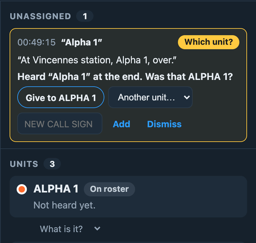

# Call signs from the words

Who sent a radio report, read from its words and matched against the mission's roster [200]. Status on 21 Nov, 18:45 Paris time: the reader and its eval are built (`lib/geo/callsigns.ts`, `evals/callsigns.cases.json`), and the coordinator uses it for radio reports, with the mission's roster, the command post's Unassigned tray and two guards ([In the coordinator](#in-the-coordinator), decisions 201 to 205). A phone that joins still names itself.

## Why

Heard third hand from a Lysk mentor on 21 Nov: units carry radios, and a live operator is on the other end. Reports will arrive as radio audio at the command post, not from phones that join a mission. So the call sign has to come from the words. The phone app stays, as a walkie-talkie stand-in.

The one rule: **a transcript never creates a unit** (Alex, 21 Nov). A garbled call sign must not put a new marker on the map, and a wrong unit moving is worse still. So the reader can only name a unit that is already on the roster, ask which one, or leave the report for the operator.

## What it answers

`matchCallsign(transcript, roster, opts)` returns one of three answers. Each keeps the words it read (`heard`), as speech-to-text wrote them, and a `why` for the log.

| Answer | When | Examples, roster ALPHA 1, ALPHA 2, BRAVO 2, CHARLIE 3, СОКІЛ, ГРІМ |
|---|---|---|
| `unit`, `exact` | The words are a known spelling of one roster entry | "Alpha 1, at the château", "Alfa one", "Alpha-1", "Альфа один", «Від Сокола» |
| `unit`, `near` | Garbled, and close to exactly one roster entry | "Alpha won", "Charlie tree", "Charly 3", "Sokil", «Сокил», "Charlie" with no number (one Charlie) |
| `ask` | Two roster entries are close, or one is and the words may name a unit not on the roster | "Alpha" (ALPHA 1 or 2), "Alpha to base", "Charlie to base" (CHARLIE 3, or a CHARLIE 2 not on the roster) |
| `unassigned` | No sender said, or a call sign not on the roster (`read`) | "I'm at the château"; "Delta 4, checking in" (read DELTA 4); "Charlie 1" (read CHARLIE 1) |

No model is involved, as for track numbers and the subject of a report [147].

## Where the sender is

Radio procedure puts the sender first, or right after the station being called.

- **At the start:** "ALPHA 1, at the château", "ALPHA 1 to base", «Сокіл на зв'язку». Fillers before it are skipped: "uh", "okay", "roger", "hello", «так», «ну».
- **After the command post's call sign:** "BASE, this is ALPHA 1", "BASE, ALPHA 1", "PC de Charlie trois", «Базо, я Грім», «Базі від Грома». The command post's call sign is skipped, said once or twice: it is who is being called.
- **After "this is"** and its kin, within the first eight words: "this is", "ici", "c'est", «це», «тут», «я», «від», «на зв'язку», «доповідає», «это». So "Hello all stations, this is BRAVO 2" works.
- **Unit to unit:** "BRAVO 2, this is ALPHA 1" is ALPHA 1; the first call sign is who is called.
- **The command post speaking:** "ALPHA 1, this is BASE, report your position" and «Соколе, я База» are unassigned: the command post is calling, so no unit reported.
- **Later in the message:** not the sender. "ALPHA 1: BRAVO 2 is at the church" is ALPHA 1. "I'm with Bravo 2 at the church" has no sender.
- **At the very end, as a sign-off** [237]: "At the town hall, Alpha 1, over." See [A call sign at the end](#a-call-sign-at-the-end).

## A call sign at the end

Pilots give their call sign last: "Climbing to five thousand, Speedbird 123." Some radio users do too. The reader takes a call sign at the end of a transmission as a **question for the operator** [237]: the report waits in the Decisions list [240] with "Heard “Alpha 1” at the end. Was that ALPHA 1?", and **Give to ALPHA 1** (key 1), then the confirm, gives it to ALPHA 1. The picture below is from before the Decisions list, when held reports had a tray of their own. It never gives the report to the unit by itself.



Why a question: speaking to a unit looks the same as signing off. "Push up to the station and hold the north entrance, Bravo 2" and "Go ahead, Alpha 1" end exactly as a sign-off does. Two rounds of held-out cases showed that no rule of this kind tells them apart ([the scores](#the-sign-off-rounds-22-nov)), and a wrong unit moving is the worst thing the reader can do. A person can tell at a glance.

Even the question is asked narrowly, because a sentence can end with another unit's call sign in more ways than any list of words can hold: "linking up alongside Bravo 2", "200 metres from Alpha 2", "cannot raise Charlie 3, over". So it needs a sign that the call sign stands apart. All of this must hold:

1. **Nothing at the start named a sender.** If the start gives any answer, a unit, a question or a call sign not on the roster, the start wins. One addition: when the report opens with the command post's call sign and no sender follows ("Base, at the town hall, Alpha 1"), the sign-off is read.
2. **It is the last thing said,** or is followed only by closing words: "over", "out", "over and out", "standing by", "listening", «terminé», «à vous», «parlez», «прийом», «кінець зв'язку», «приём», «конец связи». "Thank you", "thanks", «merci» and «дякую» count too: Whisper writes them for the silence after the last word.
3. **Its number was said.** "Alpha 1", "Alpha one", "Alpha won". "Charlie" alone at the end may be a checkpoint, so it is not enough, though at the start the only Charlie is a near match. A personal call sign with no number («Сокіл») needs none.
4. **A pause is written right before it:** a comma, a full stop, a dash. Speech-to-text writes one where the speaker paused. With "this is" or "from" before the call sign, the pause comes before those words: "At the town hall, this is Alpha 1." With no pause written, the call sign is part of the sentence: "At the town hall Alpha 1 over" waits in the tray with no unit suggested.
5. **The word before it does not tie it in,** even after a pause: "with", "near", "see", "to", "on", «avec», «près de», «біля» and about a hundred more (`TIES` in `lib/geo/callsigns.ts`). So "Track 2, request eyes on, Charlie 3" has no sender: "eyes on Charlie 3" could be about Charlie 3. With "request eyes on", say the call sign first.
6. **It does not speak to someone.** No question mark, and no "you" or "your" before it: "Are you still at the church, Bravo 2?" is to Bravo 2, not from it.
7. **Something was said before it.**

When the operator gives the report to the unit, the words before the call sign are what the model reads, with a request for recon cut out as usual: "Unknown vehicle at the town hall, send the drone, Alpha 1, out" is "Unknown vehicle at the town hall" and a request (`afterCallsign` in `lib/reports/radio.ts`).

Two more things came out of the same tests:

- **The command post signing off.** When the start names a unit and the transmission ends with the command post's own call sign after a pause, the command post is speaking: "Alpha 1, move to the station and report, Base out" is held, as "Alpha 1, this is Base" is. Before, it was read as ALPHA 1 moving to the station. "Alpha 1 to Base, over" is still from ALPHA 1.
- **Closing words are cut before the model reads.** "over", and after a pause "out", "standing by", «прийом» and Whisper's "Thank you." Left in, the offline model read "at Vincennes station, over." as no position at all (`withoutClosing` in `lib/reports/radio.ts`). "Moving out" keeps its words.

### The sign-off rounds, 22 Nov

Each held-out round was written by a separate agent from the rule's text alone, without the code, and scored before anyone looked at it. "Beyond" cases were written to get past the rule: the answer wanted is what a careful operator would want.

| Round | Cases | Result | What changed |
|---|---|---|---|
| 1, the rule as written | 30 | 30 passed, no wrong unit | |
| 1, beyond the list of tie words | 10 | 0 passed, **9 wrong units** | The first rule gave the report to the unit unless a listed word came before the call sign. "Linking up alongside Bravo 2" got past. A written pause before the call sign became a condition |
| 2, the rule as written | 16 | 16 passed, no wrong unit | |
| 2, beyond, no sender wanted | 12 | 0 passed, **12 wrong units** | Orders and replies that end with who they are for, a list of units, a number plate. The answer became a question for the operator, never a unit |
| 2, beyond, a real sign-off | 8 | 1 passed, no wrong unit | No pause written, "wait out", "Thank you for watching": these wait in the Decisions list with no suggestion |
| Both rounds, as the reader is now | 76 | **no unit named by itself where none was wanted** | The 12 get a question the operator turns down |

56 of the held-out cases are in `evals/callsigns.cases.json` with the answer the reader now gives, 5 of them rewritten when the pause became a condition (tagged `rule_changed`). The 20 beyond cases of round 2 are in `evals/callsigns.signoff-limits.json`, as a record of what the reader cannot tell; they are not part of `npm test`.

**What it cannot tell.** Whether a call sign after a pause is who speaks or who is spoken to. It asks. On a net that signs off this way, the unit you speak to goes first and you go last. Real sign-offs said with no pause, or with closing words not on the list, get no suggestion: the operator picks the unit from the roster, as for any report with no call sign.

The command post's call signs default to BASE, CONTROL, ZERO, HQ, COMMAND POST, COMMAND, PC, POSTE DE COMMANDEMENT, БАЗА and ШТАБ, in any case («Базо», «Базі», «штабу»). `opts.station` replaces them, for a mission whose command post has its own call sign.

## Forms it reads

- **NATO spellings,** with the others speech-to-text writes: Alpha or Alfa, Juliett or Juliet, Whiskey or Whisky, "Fox trot" and "X ray" in two words, and Cyrillic spellings in any case («Альфа», «Альфи», «Чарлі», «Браво»).
- **Numbers:** digits, and words in English, French and Ukrainian (with some Russian): "one", "un", «один», «два». NATO's own "niner", "fower", "fife", "wun" and "ait". Digits said one by one: "Alpha zero one" is ALPHA 1, and "one two" is 12 only when the roster has a 12.
- **Joined forms:** "Alpha-1", "Alpha1", «Чарлі-3».
- **Ukrainian personal call signs** that are plain words («Сокіл», «Грім»), in any case: «Сокола», «Соколові», «Грома», «Грому». The last syllable may change («Сокіл», «Сокола») and a vowel may drop («Орел», «Орла»). The Russian form («Сокол», «Гром») matches too.

A number after a call sign without one is the report, not part of the call sign: «Сокіл, два кілометри на північ» is СОКІЛ. A number after a call sign with one is read only as far as it goes: "Alpha one, two hundred metres east" is ALPHA 1, not ALPHA 12.

## When it asks instead of picking

A near match counts only when exactly one roster entry is close. Moving the wrong unit is worse than clutter, so:

- **The word or the number may be a guess, not both.** "Alpha won" (a word that sounds like one) and "Charly 3" (a word that sounds like Charlie) are near matches. "Alpa won" is unassigned.
- **A lost number is a doubt.** "Alpha, at the château" asks between ALPHA 1 and ALPHA 2. With one Charlie on the roster, "Charlie" is CHARLIE 3, near.
- **"to" and "for" are read both ways.** Each may be "two" or "four", or the word itself, as in "ALPHA 1 to base" with the number lost. "Alpha to base" asks between ALPHA 1 and ALPHA 2. "Bravo to base" is BRAVO 2 either way, the only Bravo. "Charlie to base" asks about CHARLIE 3, because "to" may also be CHARLIE 2, who is not on the roster.
- **A clear number that is not on the roster is another unit.** "Charlie 1" with only CHARLIE 3 on the roster is unassigned, read CHARLIE 1, not a near match for CHARLIE 3.
- **NATO words are never near each other.** "Delta 1" is never close to ALPHA 1. A NATO word with no number is a word, not a call sign: "Golf course", "Hôtel de ville" and "Victor Hugo street" read nothing.
- **Near in sound** means one letter off from four letters up, two from seven, on a rough sound key in Latin letters (so «Сокил» and "Sokil" are close to «Сокіл», "Charly" and "Sharlie" to Charlie). Shorter words must sound the same.

## The eval

```bash
npm run eval:callsigns                # every case: the misses and a summary; exits 1 on a miss
npm run eval:callsigns -- --all       # every case, passed or not
npm run eval:callsigns -- --tag uk    # cases with any of these tags
```

`evals/callsigns.cases.json` holds one roster (ALPHA 1, ALPHA 2, BRAVO 2, CHARLIE 3, СОКІЛ, ГРІМ) and one case per line: the transcript and the answer wanted. Only the fields given are scored: `kind`, `callsign`, `how`, `candidates` (as a set), `read` (`null` for no call sign read). A **wrong unit** is the worst miss, marked `UNIT!`: a unit named where the case wants a question, no unit or another unit. That unit would move. No model is called, so `tests/callsigns.test.ts` runs every case in `npm test`: all must pass, and none may give a wrong unit.

Tags: `clean`, `number_word`, `nato_spelling`, `joined`, `procedure`, `station` (the command post's call sign), `filler`, `stt_error` (garbled the way speech-to-text garbles), `number_doubt`, `unknown` (not on the roster), `none` (no call sign said), `later` (another unit named in the message), `trap`, `fr`, `uk`, `uk_case`, `personal`, `mixed`, `held_out`, and for a call sign at the end `signoff`, `sender`, `beyond`, `rule_changed`.

### Scores, 21 Nov

| Round | Cases | Passed | Wrong units | What it was |
|---|---|---|---|---|
| 1 | 75 | 75 | 0 | Written with the rules, before the code. It passing proves little. |
| 2 | 23 more | 11 | 2 | Aimed at what round 1 missed. The two wrong units were the command post speaking ("Alpha 1, this is base", «Соколе, я База») read as the unit called. Also missed: a station said twice, "roger" and «так» before the call sign, "Alpha zero one", «на зв'язку Сокіл», «доповідає Грім», and NATO words in place names read as call signs ("Golf course"). All fixed. |
| Held out | 25 more | 25 | 0 | Written by a separate agent from the rules alone, without the code, then scored before anyone looked at them. |
| All, 21 Nov | 123 | 123 | 0 | `npm run eval:callsigns`, and in `npm test` |
| All, 22 Nov | 220 | 220 | 0 | With the cases for a call sign at the end [237]: 41 written with the code and 56 held out ([the rounds](#the-sign-off-rounds-22-nov)) |

What this does not show: every transcript is written by hand, in the way speech-to-text garbles. None is real output from radio audio. The next measure is real clips through the offline Whisper turbo [195] and Voxtral, with their transcripts added as cases.

## Known limits

- **An unknown personal call sign at the start is not read.** «Беркут, біля школи» is unassigned with nothing read: any word could be a call sign. After «тут», «я», «це» or "this is", a word with a capital letter is read («Я Беркут» reads БЕРКУТ). A transcript in lower case loses that.
- **A call sign without a number takes a number after it as the report.** If СОКІЛ and СОКІЛ 2 are both units, put both on the roster: "Сокіл 2" then asks between them.
- **A lost number before a number word is not seen.** "Bravo, two drones at the church" from a BRAVO whose number was lost reads BRAVO 2: it is the same words as "Bravo two, drones at the church".
- **The sender is the first call sign.** "Bravo 2 is at the church", said by another unit without its own call sign, reads BRAVO 2. The position is still BRAVO 2's, so the marker is right; "Bravo 2 is 200 metres north of me" would not be.
- **Numbers in English, French and Ukrainian only,** with some Russian. Ukrainian ordinals («перший») are not numbers here.

## In the coordinator

Built on 21 Nov (Alex: "Yes, start step 2"). The code is `lib/reports/radio.ts` (who sent it, the guards), `lib/reports/record.ts` (saving), `app/api/report/route.ts` and `app/api/sessions/[code]/held/[id]/route.ts`. The fields are in [contracts.md](contracts.md).

**The roster [201].** The operator types the call signs on the radio net when opening a mission, split by commas. The operator can add one later from a held report in the Decisions list [240]. A phone that joins puts its call sign on the roster too; the transmitter no longer joins, so this is only for older phones [208]. The units list shows each roster unit from the start, "On roster, not heard yet". Only the operator adds a call sign: **a transcript never creates a unit.**

**A radio report [202]** is a report to a mission with no `callsign` field. Every report from the transmitter's microphone is one: like a radio, the phone does not join or name itself [208]. The coordinator reads the sender from the words:

| The reader answers | What happens |
|---|---|
| One unit, exact or near | The report goes to that unit, as if it had come from its phone. It keeps the call sign as heard and how it matched. The model reads only the words after the call sign: with "Charlie 3," in front, the offline model read "Charlie 3, checking in, at the town hall." as a sighting of something else. |
| No call sign, one unit's question open in the last 2 minutes | It is that unit's reply, and goes to it [204]. It is then read as a new report, as a phone's would be: spoken answers are not built yet [199]. |
| Ask which, a call sign not on the roster, no call sign, the command post speaking, no words | Held for the operator. |

**Held reports [203, 240].** A held report waits in the command post's Decisions list, tagged "Unit?", with its words, its recording and the question for the operator ("Heard “Alpha”. Which unit sent this: ALPHA 1 or ALPHA 2?", "CHARLIE 3 is not on the roster. Add it, or give the report to a unit."). The operator can give it to a unit it may be from, to any unit on the roster, add the call sign it read ("Add CHARLIE 3") or one typed in, or dismiss it: 1 to 9 give it to the units offered, N dismisses it, and "Another unit…" and "New call sign" are under the options. Each is asked once more first, and Enter confirms. A report given to a unit is read again from where that unit was when the report came in, since "200 metres north of me" depends on who said it. The first decision stands. The recording is kept on the coordinator under `.data/sessions/audio/`, and moves to `deleted/` with the mission.

**Two guards [204]** ask the operator instead of acting:

- **A move the unit could not have made.** A radio report that would put a unit farther than 15 m/s allows from its last fix, plus that fix's size and 100 m (the check of decision 188), is held: "ALPHA 2 moved 3.0 km in 20 s. Was that ALPHA 1?". The units named are those that could have got there. A unit still at the start point, or never placed, has no fix to measure from, so its first place is not checked. Phones are not checked: a phone names itself.
- **A reply with no call sign.** As in the table: to a unit only when exactly one unit's question is open and was asked in the last 2 minutes. Two open questions: held, asking which.

**Roster hints [205].** The roster's call signs go first in the hints sent to Voxtral with a radio report, so it writes them as the roster does. The offline Whisper turbo takes no prompt [195], so offline the reader works from what Whisper wrote, as the eval assumes.

### Not done

- **No real radio audio yet.** Radio reports were checked typed and in tests. The next measure is real clips through Whisper and Voxtral.
- **A reply with no call sign can replace the question.** It goes to the unit, then is read as a new report, since spoken answers are not built [199]. Tried on the offline model: "The first one." in reply to "Which town hall?" became a new question about the château. Wiring the reply reader in is the fix.
- **An answer is not checked for reachability.** The far-move guard checks a radio report's own place, not the place an answer picks later.
- **A `far` report's place is not drawn on the map** while it waits; its decision says it in words.
- **A held report given to a unit is dated when the operator gave it,** not when it came in. The next reachability check for that unit then counts from the later time, so it is a little stricter.
- **The command post's call sign is the default list.** `opts.station` is not set from the mission yet.
