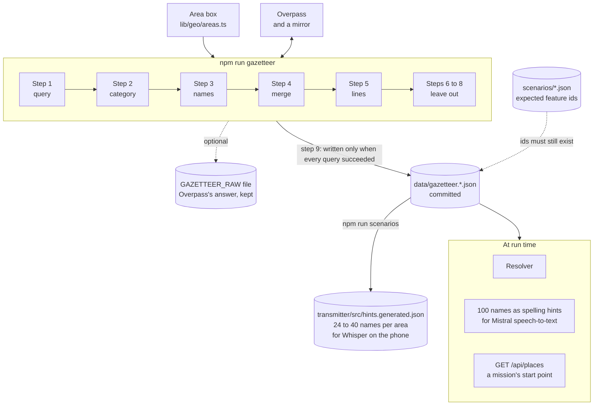

# Gazetteer

The app places every report against a local list of named places from OpenStreetMap, one JSON file per area. A script builds the files and they are committed; the running app never calls OpenStreetMap.

## How it is built

`npm run gazetteer -- <area>` runs `scripts/build-gazetteer.ts`:

1. **One Overpass query** over the area's box from `lib/geo/areas.ts`. It asks for named stations; places of worship, town halls, schools, hospitals, police, post offices, libraries, theatres, cinemas and markets; historic sites; museums, attractions and artworks; parks, gardens, stadiums and forests; cemeteries; bridges; squares and neighbourhoods; bus, tram and trolleybus stops; fuel stations and pharmacies; hotels and hostels; named lakes and ponds; named buildings that are none of these; every named river, canal and stream, with its line; and every named road from trunk down to footway, with its line.
2. **A category for each place:** church, metro_station, castle, town_hall, school, hospital, police, park, cemetery, bridge, street, stop, fuel, pharmacy, hotel, water, building or other, plus a subtype (the kind of road, stop or water, the kind of "other"). A bus station is a stop, not a station, so "the station" never means it (21 November).
3. **Every name it goes by:** `name`, `name:uk`, `name:fr`, `name:en`, `int_name`, `alt_name`, `short_name`, `official_name`, `old_name`, `loc_name`, `name:ru`, `brand`, and a Latin spelling of the Ukrainian name, so "Khreshchatyk" matches when OpenStreetMap has no English name. A fuel station or pharmacy with no name of its own takes its chain's name.
4. **Duplicates merge:** same name, same category, within 300 m. A station's point wins over its entrance or platform, and a stop's two sides of the road become one stop.
5. **Street pieces become streets:** see [Same-name streets](#same-name-streets). River pieces are joined the same way, and only the stretches within 500 m of the area are kept. A stretch in a culvert or tunnel is left out: Kyiv's Хрещатик, Кловиця and Скоморох streams run under the streets, and nobody stands by them. A river is a line, like a street: "near the Dnipro" is placed on the bank nearest the speaker.
6. **Far places are left out.** A place is placed at the middle of its outline. For something that only touches the area (a river's whole water surface, a medieval trade route, a university spread over the city) that middle is far away, so anything more than 1 km outside the box is dropped.
7. **Stops and buildings that only repeat a nearby name are left out.** The "Bérault-Métro" bus stop next to Bérault metro, or a "Хрещатик" stop on Khreshchatyk, would add a question and no new place. A stop or building whose name, without its type words, matches another place within 400 m is dropped: 55 in Vincennes. Named roofs, kiosks and sheds ("Caisse") are dropped too.
8. **Military offices are left out.** The gazetteer is streets and civilian landmarks only. A place tagged `military`, `office=military` or `government=military` is dropped, and so is an enlistment office mapped as a plain government office, by its name ("Військкомат", "ТЦК"). A museum piece (`historic`) stays. A street named after a unit is a street name and stays (21 November).
9. **The file is written only when every query succeeded.** Overpass is often busy; the script retries, alternating with a mirror, and leaves the old file alone if it gives up. With `GAZETTEER_RAW=<file>` the build keeps Overpass's main answer in that file and reads it back on the next run, so changing the build's rules does not query a busy server again.

From OpenStreetMap to the running app. The numbers are the steps above.

The report endpoint loads the file once on the server (`lib/geo/gazetteer.ts`). Name search scans every entry with a cached index. The 100 place names sent to speech-to-text as spelling hints come from the same file, stations first. Pharmacies, fuel stations and buildings come last, so they never crowd out the landmarks.

**What it still leaves out:** shops, cafés and restaurants, banks, and house numbers. OpenStreetMap has them (about 1,200 shops and cafés in the Vincennes box and 3,500 in Kyiv, counted 20 November), but each needs more than a query line. Many shops belong to chains, so the resolver needs "the Franprix on rue de Fontenay", a place narrowed by a street, before they help more than they ask back. House numbers are a street plus a number, not a name, and need a field in the intent. See [known gaps](known-gaps.md).

Rebuild on purpose, not routinely: OpenStreetMap changes daily, so a rebuild can change counts and, rarely, ids. After one, compare the counts the build prints with the old file, run `npm test` and the scenarios, and update the counts in the README and [architecture.md](architecture.md).

Rebuilt 20 November with the new kinds of place [123]:

| | Vincennes | Central Kyiv |
|---|---|---|
| Places | 1,108 (was 911) | 2,840 (was 2,112) |
| Stops | 31 | 44 |
| Pharmacies | 38 | 142 |
| Hotels | 24 | 104 |
| Fuel stations | 1 | 5 |
| Water | 4 | 25, the Dnipro among them, as a line |
| Named buildings | 96 | 406 |

Checked the same evening by replaying the 9 demo reports through hosted Mistral against the old and the new file: all 9 give the expected answer with the new file. New test reports for each kind of place resolved: a named stop, fuel station, lake, hotel and the château's gate tower; "the pharmacy" and "the bus stop" pick the nearest or ask.

## Same-name streets

OpenStreetMap stores a street as many pieces. The build joins pieces that share a name into one street, then splits that street again where the pieces are clearly two streets:

- Pieces within 150 m of each other are one street, whatever town they are in (a street broken by a junction or a square).
- Pieces in the same town up to 1 km apart are still one street: a town does not give two streets the same name.
- Anything else is a separate street, with the name of its town. The town is the admin area at the area's `townAdminLevel` that contains the street: the commune in France (8), the city for Kyiv (4), the settlement for Izium (8). One extra Overpass query looks it up, only for names that split.

A report naming such a street is asked back, with the towns as the choices: "Which street: Rue Gambetta (Fontenay-sous-Bois), or Rue Gambetta (Montreuil)?" If the towns do not tell them apart, the question gives each one's distance instead. With a fresh last position, the usual rule applies: the nearest wins if it is clearly nearest.

Ids: a street with a unique name keeps `street/<name>`, for example `street/вулиця-хрещатик`. Streets that share a name get their town: `street/rue-gambetta/montreuil`.

In Vincennes (rebuilt 20 November), 16 names are two streets each, every pair in two different towns: Vincennes, Saint-Mandé, Montreuil, Fontenay-sous-Bois and Bagnolet. Before this rule, each pair was one street, and "on rue Gambetta" never asked which one. Two more names had pieces 200 to 300 m apart in one town and stay one street each. In central Kyiv, three names had pieces 350 to 660 m apart; all are inside the city, so they stay one street each and Kyiv has no same-name streets.

## Adding an area

1. Add the area to `lib/geo/areas.ts`: id, label, place description, centre, zoom, box, hint text and `townAdminLevel`. For the town level, use OpenStreetMap's `admin_level` of the municipality in that country, the level at which street names are unique. In Ukraine outside Kyiv that is the settlement, level 8. The hromada is level 7 and holds many villages, each with its own вулиця Шевченка. Use a central square as the centre, not the middle of the box: "the church" with no last position is looked for around it.
2. Run `npm run gazetteer -- <id>` (needs network).
3. Import the new file in `lib/geo/gazetteer.ts`.
4. Add the id to the transmitter: `AreaId` in `transmitter/src/types.ts`, the list in `transmitter/App.tsx`, and `MAX_NAMES` in `scripts/build-transmitter-hints.ts`. Then run `npx tsx scripts/build-transmitter-hints.ts`. The web page and the receiver list the areas themselves.
5. Run `npm test`, and try a few typed reports in the web page.

A coordinator that is running picks up a new area only when the import and the file are both there. Create the file first, then the import, then the area.

## Izium, added Saturday 21 November

A third area: Ізюм, a town in Kharkiv Oblast on both banks of the Siverskyi Donets, with 45,000 to 50,000 people before 2022. It was occupied from April to September 2022 and is known for that. It is under Ukrainian control; about 29,000 people lived in its community in 2025 (Suspilne). Status of everything below: Saturday 21 November, 02:00 Paris time. On the live site since the deploy of 21 November, 09:10.

**Why Izium.** It is the only candidate with enough in OpenStreetMap for the demo, and nobody disputes who holds it. Lysk's sentences work there: a named station, two cathedrals and a church, a central square, a river, a district hospital, 503 streets. It also has real ambiguity: two churches 345 m and 620 m from the central square, a street and a lane both called Шевченка, three waterways within reach of one spot.

**How far from the front.** Not measured on a map dated this week; this is from reports. The head of the town's military administration said about 30 km in 2025 (Suspilne). Since then the September 2026 counterattack around Lyman pushed that side of the front back: ISW on 10 November put it more than 20 km east of Sviatohirsk, which is 27 km from Izium, so about 45 to 55 km. To the north-east, ISW on 4 November listed a Russian effort to cross the Oskil; Borova, on its east bank, is 32 km from Izium, and no November report says where that line runs. So: about 30 to 45 km, at the far edge of what we wanted. The town is still hit by glide bombs: 2 November, one dead and 11 injured (LB.ua); 15 and 27 October (Ukrinform, Censor.net).

**The shortlist.** Counted with one Overpass query per box on 21 November, named objects only unless said.

| | Izium | Sviatohirsk | Shevchenkove | Barvinkove |
|---|---|---|---|---|
| Oblast | Kharkiv | Donetsk | Kharkiv | Kharkiv |
| Front | about 30 to 45 km | 20 to 30 km east (ISW, 10 Nov) | Kupiansk, contested, 32 km east (EUobserver, 11 Nov) | 45 km or more |
| Control | Ukrainian | Ukrainian; Russia claimed it on 1 September, ISW and Ukraine say no | Ukrainian | Ukrainian |
| Box | 7.2 × 8.0 km | 5.6 × 7.3 km | 5.3 × 6.5 km | 6.1 × 7.3 km |
| Street names | 496 | 35 | 74 | 70 |
| Street pieces with `name:uk` | 698 of 702 | 51 of 51 | 92 of 133 | 96 of 96 |
| Places of worship | 7 | 6 | 1 | 1 |
| Schools | 20 | 1 | 4 | 5 |
| Hospitals and clinics | 12 | 2 | 1 | 1 |
| Town halls | 2 | 1 | 2 | 0 |
| Rail stations | 1 | 0 | 1 | 2 |
| Bridges with a name / road bridges | 0 / 12 | 0 / 3 | 0 / 11 | 0 / 12 |
| Named rivers and streams (pieces) / lakes and ponds | 8 / 3 | 1 / 5 | 9 / 1 | 2 / 1 |
| Cemeteries (named) | 6 (3) | 3 (0) | 4 (1) | 8 (0) |
| Fuel stations | 14 | 2 | 4 | 3 |
| Pharmacies | 21 | 4 | 3 | 4 |
| Named bus stops | 33 | 3 | 5 | 0 |
| Buildings drawn | 12,270 | 1,019 | 4,043 | 4,978 |
| Settlements in the box | the town, 1 village | the town, 1 village | the town, 4 villages | the town |

Sviatohirsk has the Lavra and is close to the front, but 35 street names are too few, Russia claims it, and the only mirror that answered had data from 24 July. Barvinkove is too far and too thin. Shevchenkove is the village-scale choice: the town and four villages in one box, where Шевченка, Польова, Набережна, Зелена, Зоряна, Молодіжна and Сонячна each exist more than once, so the same-name street question would name the villages. It has one church and few landmarks. One of its villages is Hroza, where a missile killed 59 people at a wake in October 2023. Adding it later is one area entry and one command.

**Not counted.** Places south of the Donbas and in Sumy Oblast: the searches turned up no report from this month of where the front runs there. Druzhkivka, Kramatorsk and Sloviansk: cities, and too close to the fighting at Kostiantynivka and east of Sloviansk (Kyiv Post, 5 November).

**The area.** Box 49.175 to 49.245 north, 37.215 to 37.325 east, 7.8 × 8.0 km. Centre: Центральна площа, by the town hall. Town level 8, checked with Overpass: at a point in the town it returns Україна (2), Харківська область (4), Ізюмський район (6), Ізюмська міська громада (7) and Ізюм (8); at a point in the east of the box, Оскільська сільська громада (7) and no level 8, so a street there would be told apart by distance.

**What the build printed.** 964 objects from Overpass, 714 places, 350 kB:

| | Izium |
|---|---|
| Streets | 503, from 502 names, 252 km of line |
| Rail stations | 1 |
| Churches | 6: two cathedrals, a church, a wooden church, a spring bath house, a Kingdom Hall |
| Town halls | 2, the city council and the district administration, 15 m apart |
| Schools | 19 |
| Hospitals and clinics | 10 |
| Pharmacies | 16 |
| Fuel stations | 11 |
| Stops | 16, two of them bus stations |
| Water | 7: the Siverskyi Donets and four streams as lines, a lake, a pond |
| Cemeteries | 3 |
| Hotels | 4 |
| Parks | 2 |
| Police | 2 |
| Named buildings | 47 |
| Other | 65: memorials, quarters, museums, post offices, two squares |
| Bridges | 0 |
| Left out | 1 military office, 7 stops and buildings named after a place next to them, the river's whole surface (its middle is far away) |

One street name is two streets: Василя Стуса вулиця, 1.9 km apart, both in Izium, so they are told apart by distance.

**Two build rules came from this town.** Its bus station is called "Ізюм", like the railway station 3 km away, and was a station too; near the centre "the station" would have meant the bus station, without a question. Its enlistment office was in the file as a government office. See steps 2 and 8 above. Neither rule changes the files we have: the same name check finds nothing in Vincennes or Kyiv, and the three places there that touch a military tag are kept (the Bégin hospital, a museum tractor, a state office on military land). At Kyiv's next rebuild, Автостанція «Київ» becomes a stop. In Vincennes the bus station at Château de Vincennes is already folded into the metro station and would be dropped as a stop named after it.

**Checked.** The 9 reports of `scenarios/izium-demo.json` were typed into the running coordinator (hosted Mistral, no mission) four times, carrying the last position forward as the web page does. The first run gave 8 of 9: step 5 said «до річки» and was asked which of three waterways, rightly. It now names the river, and the next three runs gave 9 of 9. Step 8 came back as a pin on the crossing once and as a move towards it three times; both are the same crossing. `tests/izium.test.ts` pins the same answers against the built file. Not checked: speech, a native speaker, the phone app, the receiver.

**What Izium shows is missing.**

- **Bridges.** The town has 12 road bridges and none has a name in OpenStreetMap, so "at the bridge" is not placed. It needs a rule: a road bridge over a named river is a place, called after the river and the road.
- **Kinds of street.** проїзд, в'їзд and тупик are not street words. «На Шевченка» offers the street and the lane, not Шевченка проїзд.
- **One street, two spellings.** "вулиця Василя Стуса" and "Василя Стуса вулиця" are both in OpenStreetMap and count as two names. So do "вулиця Самборського" and "Самборського вулиця".
- **The hill and the villages.** Kremenets, the town's best-known landmark, is a peak and is not fetched; its memorials are. Пимонівка, the one village in the box, is not a place either ([Scaling](#scaling-the-gazetteer), point 3). Its streets are.
- **Two town halls in one building.** "The town hall" asks which, between the city council and the district administration.
- **Words the model misses.** «Біля вокзалу» came back as a building and «біля автовокзалу» as a town hall, so the app asked about the wrong kind of place. «На станції Ізюм» works.
- **English names.** OpenStreetMap has almost none here. An English report has to use the kind of place or the Latin spelling: "Izium station", "the Spaso-Preobrazhenskyi cathedral".

**Sensitive.** Izium is a real town under attack, and the file is public data about it. The cemetery "Шекспіра" is where the mass graves were found in 2022; the demo script does not go there. The script is a made-up walk from the station to the hospital and names no unit or position.

## Scaling the gazetteer

Not needed for the demo; this is the answer to "what would a country take". A city or one oblast is 1 to 2 days of work; a whole country about 1 to 2 person-weeks. Data volume is not the hard part. The build tool, search, and ambiguity over a larger area are.

What Ukraine looks like in OpenStreetMap (Geofabrik's download and tag counts, checked Friday 20 November):

| | Count |
|---|---|
| Download for all of Ukraine | 885 MB (France: 5.1 GB) |
| Objects with a name | 1.10 million |
| Named road pieces (one street is usually several pieces) | 448,000 |
| Settlements | 101 cities, 2,567 towns, 43,054 villages, 5,641 hamlets |
| Places of worship, schools, hospitals, town halls, police | 16,299 · 13,821 · 3,588 · 2,895 · 1,857 |
| Rail stations and halts | 1,979 + 2,799 |

For comparison, central Kyiv today is about 2,800 places in a file of about 1 MB over about 27 km². With our filters, Ukraine would be a few hundred thousand places, very roughly 100 to 200 MB as one file like today's. That size is an estimate, not a measurement.

What breaks, in order:

1. **The download.** Overpass is a public service for small queries; a country query will not run there. Download Geofabrik's file and filter it with osmium instead, which takes minutes on a laptop. The sorting and naming code stays. About 1 day.
2. **Streets with the same name.** Solved for our two areas ([above](#same-name-streets)). Over a country the same rule holds, but the town lookup has to come from the boundaries in the downloaded file instead of Overpass, and the town level differs per country. Part of the day above.
3. **Towns and villages are missing.** Only squares and neighbourhoods are kept, so "I'm in Bucha" cannot be placed. A small change.
4. **Search.** The report endpoint loads the whole file and checks every name on every report. At hundreds of thousands of places, each cold start would load about 150 MB and each search would walk every entry. Use a store with a location index and a name index, and search only around the speaker. One SQLite file per region does both and works the same offline on the laptop; the hosted site can use the same file, or PostGIS. About 2 to 3 days.
5. **Ambiguity.** "Nearest" is measured from the last position or the area's centre. Over a country, a name with no recent position matches hundreds of places. Each session needs an operating area, searched first, and the intent needs a town when one is said ("the church in Irpin"). The 100 place names sent to speech-to-text must come from around the speaker, not the whole area. About 1 to 2 days, plus testing.

How the gazetteers would be managed:

- **Built by a pipeline, never edited by hand.** Each file records the date of its OpenStreetMap data, the script version, counts per category and a checksum, as the voice model does [45].
- **One file per region.** Ukraine has 24 oblasts plus Kyiv city. A laptop or phone loads only its operating area; the hosted server can hold them all.
- **An overlay per operation** for names OpenStreetMap does not have or should not have: nicknames and reference points ("checkpoint 3", "the water tower"), corrections, places that no longer exist. It sits on top of the OpenStreetMap layer and wins where they disagree. The OpenStreetMap layer is public anyway; the overlay is where the sensitive data lives, so access to it needs controlling.
- **Updates on purpose, not automatically.** Geofabrik publishes daily. On a rebuild: compare it with the previous version (counts per category, places renamed or removed), run the scenario and evaluation tests, then switch over. Never mid-operation. Each saved report records which version placed it, so it replays exactly. The comparison matters more in Ukraine, where contested areas may be edited, vandalised or deliberately left blank.
- **Licence.** OpenStreetMap data is under the ODbL. A gazetteer built from it must credit OpenStreetMap, and a database handed to others outside the team must carry the same licence. Whether an overlay counts as part of that database needs a proper check before anything ships.
