# Tracks

A track is something on the map that is not a reporting unit: a vehicle, people, a drone, a team. A unit reports it by voice, the coordinator gives it a number, and the command post draws it with its standard symbol. Tracks are for reconnaissance only [234]: the app marks what was seen and asks when a report is unclear. It never works out anything between a unit and a track.

Built on Saturday 21 November, steps 1 to 3 of five ([plan](plan.md#tracks-what-a-unit-sees)). Placing and editing tracks by hand at the command post followed the same day ([below](#placed-by-the-command-post)). The rules are in the [README](../README.md#tracks), the fields in [contracts.md](contracts.md#tracks), and the choices in DECISIONS.md [145 to 157, 160, 167, 177, 178, 180, 182]. This page shows what it looks like and how a report becomes a track.

## The pictures

The command post pictures come from one run of the tracks script ([README](../README.md#vincennes-with-tracks)) on Saturday 21 November, 14:16 to 14:19, in mission `vincennes-2` on a coordinator of its own. The coordinator ran on the Mac in offline mode (the 3B model). Both units' reports were typed. Ten of the 11 steps got the answer the script expects. In step 11 the model read "Enemy vehicle to the east" as about the speaker, so the app asked "Is that where you are, or something you see?" instead of how far east: still no track, as expected, but a different question (in the feed of the first picture). Track 7 was then placed by hand. The phone pictures come from an earlier run, 10:40 to 10:43 in mission `vincennes-15`, in hosted mode (Mistral), with ALPHA 1 the transmitter in the iPhone 16 Pro simulator playing the script's clips. Every sighting is made up.

### The command post at the end of the script

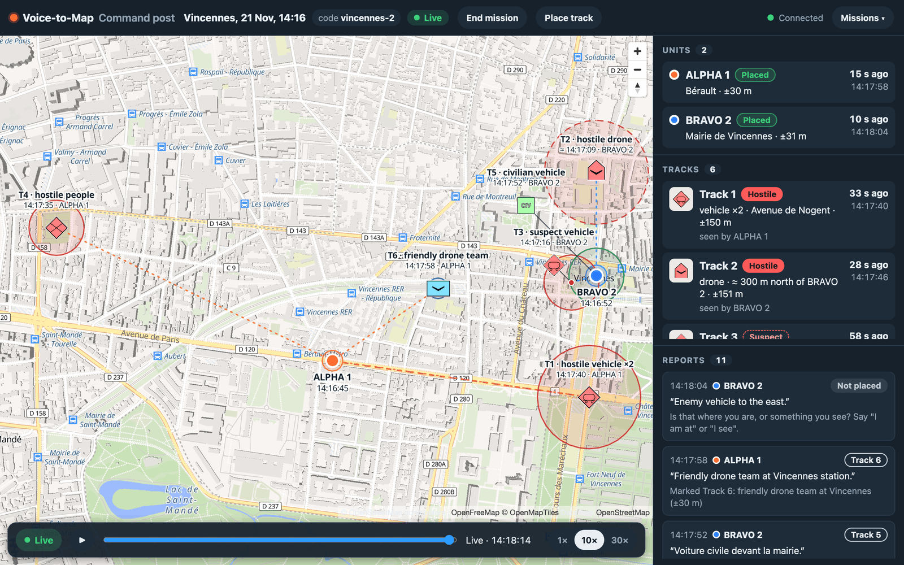

- **Units are dots, tracks are symbols.** ALPHA 1 (orange) and BRAVO 2 (blue) never moved: a report about a track does not move the speaker.
- **Each track has a label:** number, what it is, the time it was last seen and who saw it ("T1 · hostile vehicle ×2, 14:17:40 · ALPHA 1").
- **A symbol that would hide a unit or another track is drawn a short way off,** with a thin line back to a small dot on its real point ([below](#when-symbols-would-overlap)). Track 5, a civilian car at the town hall where BRAVO 2 stands, is drawn above and to the left; Track 3 is drawn beside the church.
- **A dotted line of sight** runs from the observer to each track it reported: ALPHA 1 to Tracks 4 and 6, BRAVO 2 to Track 2.
- **A dashed trail** shows where a track was before. Track 1 was first seen on Avenue de Paris and moved to Avenue de Nogent.
- **The circle** is how sure the place is. A track on a street gets at least 150 m, because the speaker did not say where along it.
- **A dashed circle and ≈** mean an estimate. Track 2 was placed 300 m north of BRAVO 2, then marked hostile without moving.
- **The list** gives each track its symbol, a word for whose it is, what and where, and who saw it. The last two tracks:

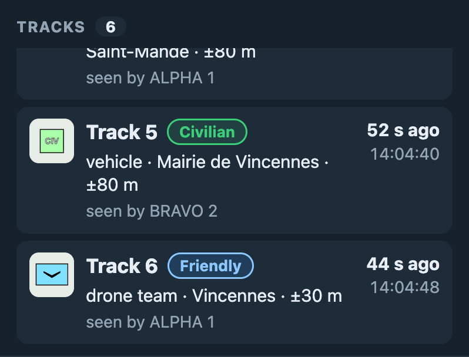

### While a question is open

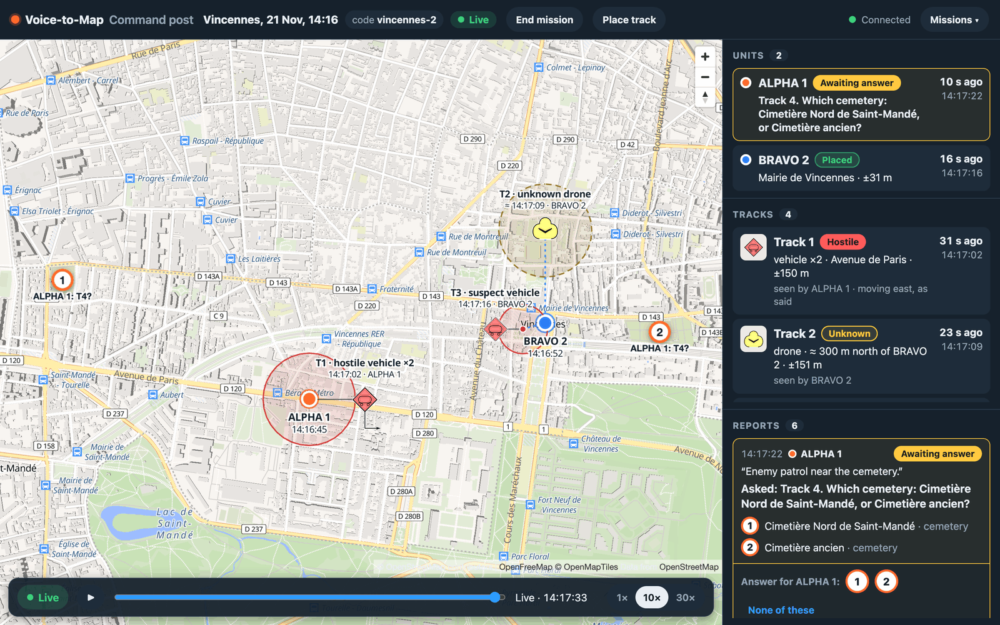

"Enemy patrol near the cemetery" could mean two cemeteries, so the app asked. ALPHA 1 shows "Awaiting answer", the question is in the unit list and the feed, and the two choices are numbered on the map ("ALPHA 1: T4?"). Track 4 already has its number but no place until the choice is tapped. Under the question in the feed, the command post can answer for ALPHA 1 ([below](#placed-by-the-command-post)); here the phone answered.

Note Track 1 at this point. Its place is on ALPHA 1's dot, because Bérault is on Avenue de Paris, so its symbol is drawn just east of ALPHA 1 with a line back ([below](#when-symbols-would-overlap)).

### An estimate

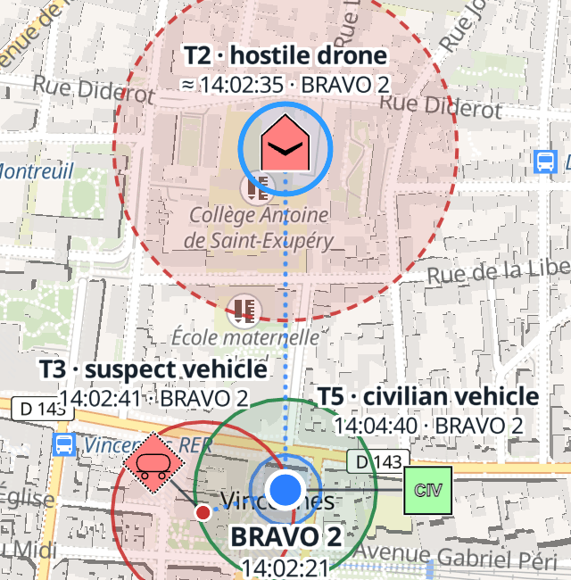

"I see a drone about 300 metres north of me" gives no place, only a distance and a direction. The track is worked out from BRAVO 2's position, so its circle is BRAVO 2's own plus 0.4 × the distance, dashed, and its time starts with ≈.

### On the phone

| Track 1 said back | The question for Track 4 | After the answer |
|---|---|---|
|  |  |  |

| A friendly track | The scenario list |
|---|---|
|  |  |

The phone says the number back aloud and on screen. The line under it is still the speaker's own position, "Bérault · ±30 m", after every report about a track. A question about a track starts with its number, and the distances are measured from the speaker. Once a choice is tapped, the phone says the number again with the place: "Track 4 placed at Cimetière Nord de Saint-Mandé (±80 m)". In the scenario list a step about a track says which track it expects ("expects Track 3, suspect vehicle") and is marked "Track 1, resolved" when it passes. In the first run, in mission `vincennes-13`, the coordinator took 1.1 to 1.6 s for each of ALPHA 1's clips, speech to text included.

## Symbols

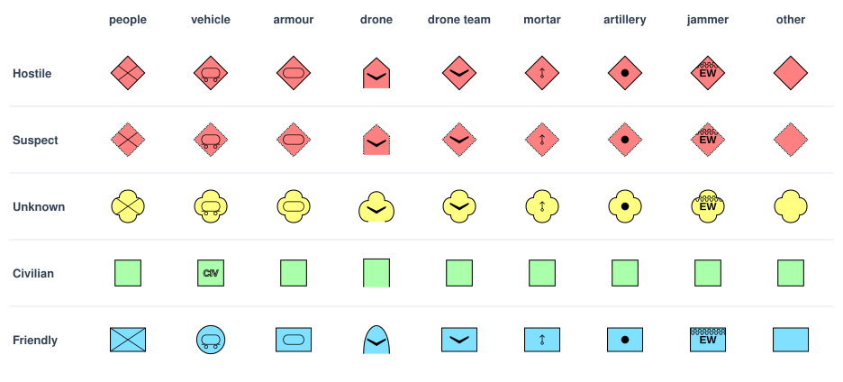

The frame says whose a track is, the icon what it is. These are the APP-6 symbols (MIL-STD-2525C letter codes) from `trackSymbolCode` in `lib/geo/trackKinds.ts`, drawn by milsymbol 3.0.5, as on the command post.

| Whose | Frame | Set by these words | Pill |
|---|---|---|---|
| Hostile | red diamond | "enemy", "hostile", «ennemi», «ворожий» | red |
| Suspect | red diamond, dashed | "suspicious", "possible enemy" | red, dashed |
| Unknown | yellow clover | nothing said: the default | yellow |
| Civilian | green square | "civilian", «civil» | green |
| Friendly | blue rectangle, a circle for a vehicle | "our", "friendly" | blue |

A civilian thing never gets a military icon: a civilian vehicle has its own symbol, anything else an empty frame. The model only picks a kind from the fixed list. It never picks a code, and it never decides whose a track is: that comes from the words [148, 151]. A drone, being in the air, gets the air frame, open at the bottom.

## How a report becomes a track

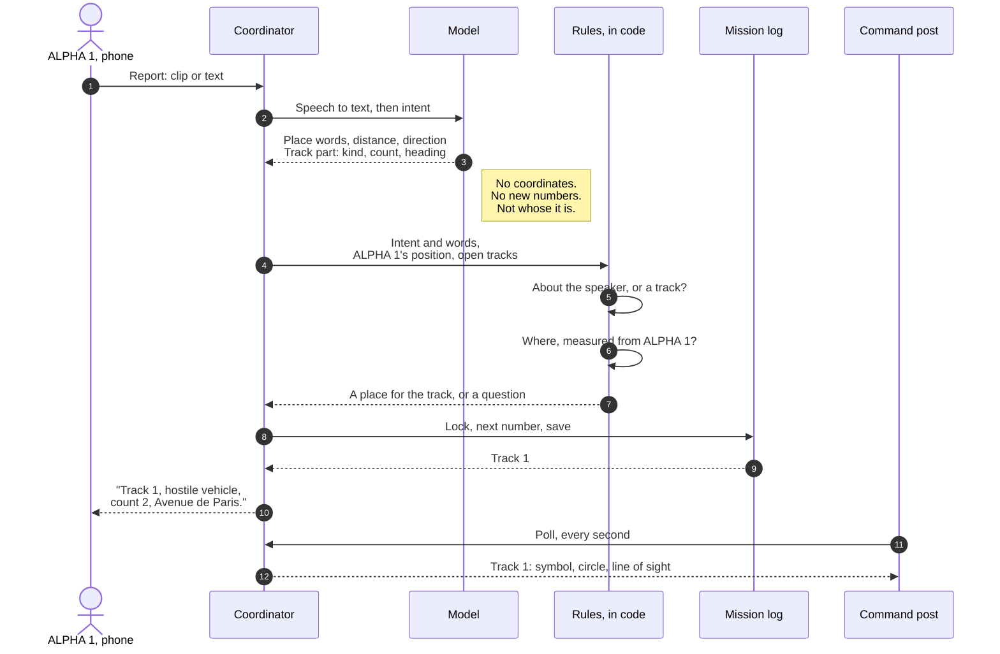

The model is Mistral in hosted mode or the 3B model on the laptop in local mode. It reads a number when one is said ("Track 3 moved …"), but only the coordinator gives new ones. The rules never return a new position for the speaker.

The number is given inside the mission's lock, so two phones reporting at once never get the same one. Numbers count up per mission and are never reused. A number carries no affiliation, so Track 2 keeps its number when it turns from unknown to hostile.

## About the speaker, or something seen?

The model reads every report as about the speaker or about a track. Code then checks that reading against the words, and asks when they disagree.

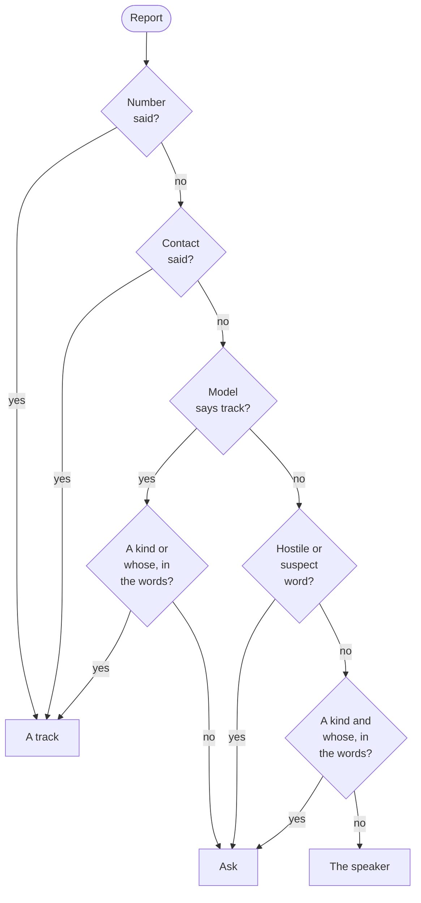

| Said | Model reads | Result |
|---|---|---|
| "Track 3 moved to the station." | anything | a track |
| "Unknown contact, two blocks east." | anything | a track [180]; the two blocks are counted along the observer's street [184], or it asks "How far east is it?" |
| "Enemy vehicle in front of the town hall." | a track | a track |
| "I can see the church." | a track | asks: no word names a thing |
| "Enemy at the station." | the speaker | asks: a hostile word was said |
| "Our drone team is at the station." | the speaker | asks: a thing and whose it is were named |
| "I'm at the station." | the speaker | the speaker, placed as before tracks |
| "Friendly at the station." | a track | a track [179]; read as the speaker, it would move the unit, since a friendly word alone is not checked |

The question is "Is that where you are, or something you see? Say 'I am at' or 'I see'." The last check was added with the script [157]: hosted Mistral read "Our drone team is at Vincennes station" as the speaker's own position and moved the unit.

**A contact** [180]. "Contact" is the radio word for something seen. It counts when it opens the report or stands next to a word for whose it is, a doubt word, unknown, new, visual or a count: "Contact, two blocks east", "enemy contact behind the castle", "contact ennemi", "невідомий контакт". "Lost contact with BRAVO 2", "in contact with the base" and "the contact point" do not count. Hosted Mistral read "Unknown Contact, two blocks east" as the speaker moving east; code now makes it a track whatever the model says. A track never moves the speaker, so this is the safe reading when it is wrong.

**Blocks** [184]. "Two blocks east" is counted along the street lines, in code; the model gives no distance for it [51]. From the observer, the count runs along the street they are on that runs east; from a street they name ("two blocks east of rue X"), along rue X if it runs east, or from where a street that runs east crosses it. "Two blocks" is the second crossing counting every street that meets this one, or the second counting only the streets that cross it right through. On Rue de Fontenay going east both counts land on Avenue de Vorges, so the track goes there. On Avenue de Paris, Rue Segond joins from one side at 79 m and Rue de Colmar crosses at 147 m, so the second crossing is Rue de Colmar or Rue de Montreuil (368 m), and the app asks which. The circle reaches back half a block. When the blocks cannot be counted, the app asks how far, in the way the speaker gave: "How far east is it? Or name a place near it.", or from a street, "How far east of Rue de Fontenay?"

## Where the track goes

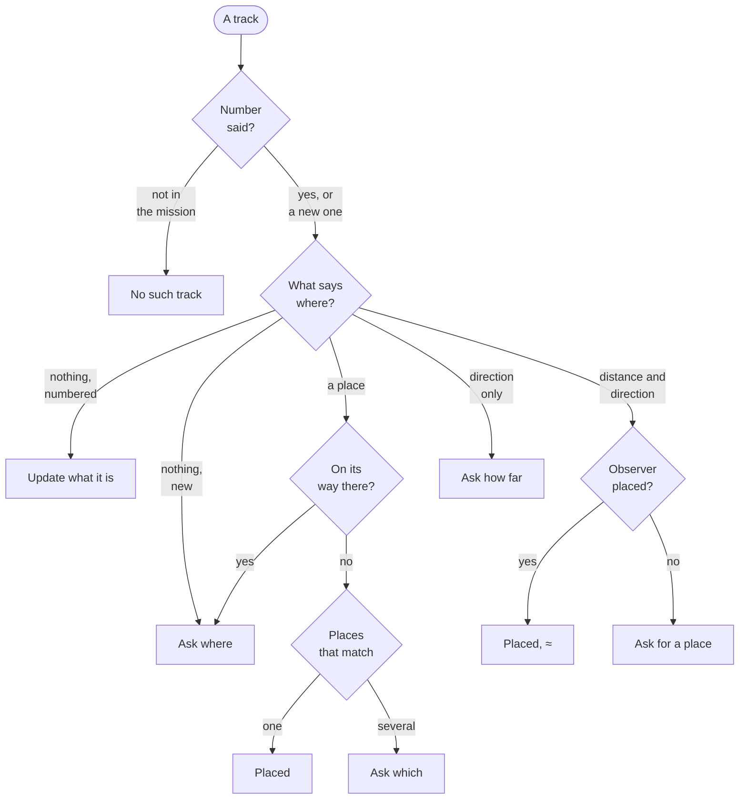

| Said | Ends at | The app says |
|---|---|---|
| "Track 9 is hostile." (there is no Track 9) | No such track | "There is no Track 9 in this mission." |
| "Track 2 is hostile." | Update what it is | "Track 2, hostile." |
| "Enemy vehicle." | Ask where | "Where is it? Name a place near it, or a distance and a compass direction from you." |
| "Vehicle heading towards the bridge." | Ask where | the same |
| "Suspicious vehicle near the church." | Placed | "Track 3, suspect vehicle, Église Notre-Dame." The nearest church to the observer |
| "Enemy patrol near the cemetery." | Ask which | "Track 4. Which cemetery: Cimetière Nord de Saint-Mandé, or Cimetière ancien?" |
| "I see a drone about 300 metres north of me." | Placed, ≈ | "Track 2, unknown drone, 300 metres north of you." |
| "Hostile drone, 1 km east, heading north." | Placed, ≈ | "Track 5, hostile drone, 1000 metres east of you." Its symbol points north [186] |
| The same, from a unit with no position yet | Ask for a place | "I don't know where you are. Name a place near what you see." |
| "Enemy vehicle to the east." | Ask how far | "How far east is it? Or name a place near it." [180] |
| "Hostile drone 1 km away, heading north." | Ask which way | "Which way is it from you? Give a compass direction, or name a place near it." [186] |

A track on a street or along a river gets a circle of at least 150 m. "Track 1 moved to Avenue de Nogent" is read as "at Avenue de Nogent": the model often reads "moved to" as "towards", so only a word such as "heading" or "on its way" makes it a direction [149]. A compass word said with a place, as in "moving east", is the way the track was moving, not where it is.

**Where it is, and the way it is going** [186]. A report can hold two compass words: "Hostile drone, 1 km east, heading north." The offline model drops one, swaps them or merges them; the swap pinned the drone 1 km north with no question. So code reads them from the words, as it reads the subject:

| The compass word comes | It says | Example |
|---|---|---|
| after a distance | where the thing is | "1 km **east**", "à un kilomètre à l'**est**", "за кілометр на **схід**" |
| before "of" | where the thing is | "**east** of me", "**north** of the church" |
| after a verb of moving | the way it is going | "heading **north**", "il se dirige vers le **nord**", "летить на **північ**", "**north**bound" |
| after "towards" or "vers", no distance before | the way it is going | "drone towards the **north**" |
| after "I'm moving", "je me dirige" | the speaker's own move: neither | |
| after "coming from" | where it came from: neither | |
| anywhere else | not clear: the model's reading stands | "Enemy vehicle to the **east**" |

When the words are clear they win over the model. One word is never both where the thing is and the way it is going. Two different words for the same role are dropped, so the app asks. When no compass word is found, the model's reading stands, since the word lists can miss one. A heading shows as "moving north, as said" in the list, and on the map as a bold dark arrow with a white edge, from the middle of the track's symbol and about one frame past its edge. The arrow turns with the map, so it points north on a turned map too. When it points up, the label moves above its tip [197]. While the sighting is fresh, light bands run along the arrow to its tip; on an old sighting the arrow is still ([below](#what-moves-on-the-map)) [238].

## A track's life

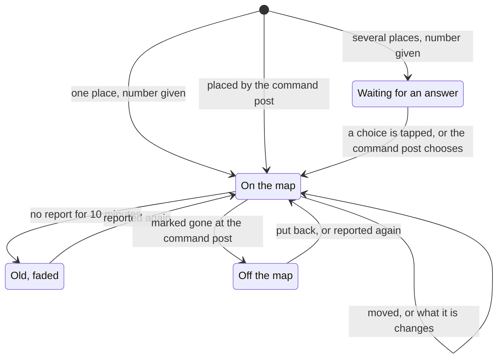

A move adds the old place to the track's trail. A change of whose it is or what it is keeps its place, its number and its trail. Not built yet: "Track 3 is gone" said by a unit, and a question when a new sighting is close to an old track ("Is this Track 3, or a new one?"). Until then every sighting without a number opens a new track.

## Placed by the command post

The command post can put a track on the map itself, for news that comes another way: a drone feed, a phone call, a radio message [177]. Press **Place track**, or P:

1. **Whose:** Hostile, Suspect, Unknown, Civilian or Friendly. It starts on Unknown, as a report with no such word does [148]. Keys H, S, U, C, F.
2. **What:** the nine kinds, each with its symbol. Keys 1 to 9.
3. **How many**, and **how sure**: a circle of 25, 50, 100 or 250 m.
4. **Where:** click the map, or find a place by name. The symbol appears in a dashed circle; drag it to adjust. The card shows the name the point gets and takes an optional source. The name is the place itself when the point is on it, or within 30 m ("Square Virginia Woolf"), otherwise a distance and a direction from the nearest place ("30 m south-east of Pharmacie Bonne Nouvelle").
5. **Place**, or Enter. The track gets the mission's next number, from the same count as reported tracks. The palette stays open for the next one; Esc closes it.

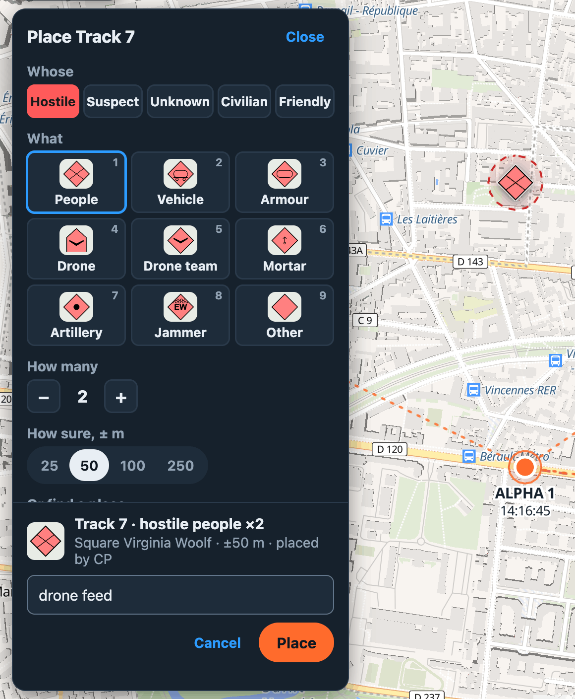

Click a track on the map or in the list for its card:

- **Change:** whose, what, how many.
- **Move:** click or find the new place. The old place goes into the trail.
- **Gone:** off the map, after a confirm. It stays in the list, last, and in the log.
- **Put back on the map**, for a gone track.

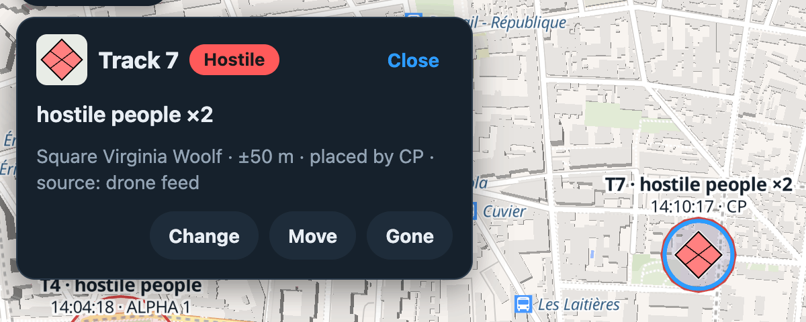

A unit's later report about the track brings a gone track back, and a placed track takes reports like any other ("Track 4 moved to the station"). Every change is one `plot` line in the log, so a replay shows it when it happened, and the feed shows it under CP. The position comes from a person's click or a gazetteer place, never from a model. The command post places tracks only; a unit's position still comes only from what the unit says.

**Answering for a unit.** Under a unit's open question the command post has the same numbered choices and "None of these". After a confirm it answers for the unit, as an operator would on a radio net [178]. The question closes, the marker moves, and the feed says "CP answered". The unit's last-heard time does not change. If the phone answers later, the first answer stands.

The controls show only on a live mission that the coordinator keeps a record of: not in a replay, and not on an ended mission.

## Recon requests and tasking

A unit can ask for a drone to look at something, in the same radio call as a report or on its own, and a person at the command post sends one [234]. The app sends nothing by itself, picks no drone, and measures nothing between a drone and a track.

**Asking.** The request words are read in code, in English, French, Ukrainian and Russian: "send the drone", "request eyes on", "need recon", "can we get a drone up", «envoyez le drone», «on a besoin d'un drone», «надішліть дрон», «потрібна пташка», «пришлите дрон», «нужна разведка». "Don't", «pas besoin» or «не» just before them means no request. "Drone up" on its own is not one ("enemy drone up north"), nor "getting eyes on", which is a reply.

A request runs to the next comma or full stop, and is cut out before the model reads the rest (`splitRequest` in `lib/geo/requests.ts`). Left in, "send the drone" made "unknown vehicle" an unknown drone, because the word reader met "drone" first, and "Track 2, request eyes on" got "Where is it?". The extraction prompt is unchanged.

| Said, after the call sign | What the model reads | The request |
|---|---|---|
| "unknown vehicle at Mairie de Vincennes, send the drone" | "unknown vehicle at Mairie de Vincennes": Track 2, an unknown vehicle | about Track 2, the track the report opened |
| "Track 2, request eyes on" | nothing: the call is only a request, so nothing is placed and nothing asked | about Track 2 |
| "send the drone to Track 3, over" | nothing | about Track 3 |
| "send the drone" | nothing | names no track: the operator picks one |

**The request.** Each request waits in the **Decisions** list, tagged "Recon", with the questions and held reports [239]. Opened, it shows who asked and when, the words, and the track. Under it is one button for each friendly drone or drone team track on the map, marked free or with the track it is looking at. The only free drone is offered first; with two free, or none, nothing is. Nothing is sent before a confirm: "Send Track 1, friendly drone team, to look at Track 2?" A busy drone can be sent instead: "Track 1 is looking at Track 3. Send it to Track 2 instead?" **Not now** declines, after a confirm, and nothing is sent. A request that names no track has a list of the mission's tracks to pick from. With no friendly drone or drone team on the map, it says to place one with Place track. The keys 1 to 9 and N do not apply to a request: its buttons are clicked. The screenshots below are from before the Decisions list, when requests had a tray of their own.

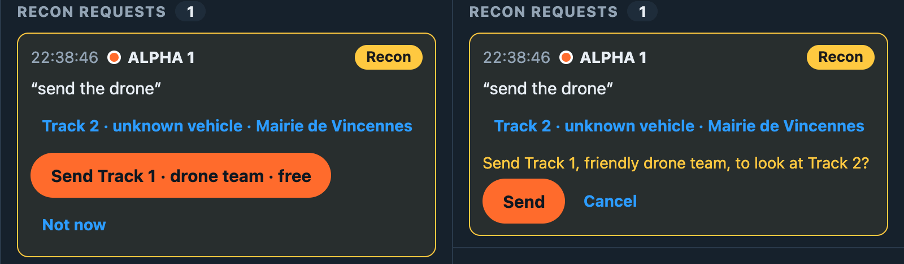

**Sent.** A solid blue line runs from the drone to the track. The feed says "Sent Track 1 (friendly drone team) to look at Track 2. ALPHA 1 had asked.", and the request's own line adds "CP sent Track 1." The track's card says "Recon: Track 1 since 22:39:42"; the drone's card says "Looking at Track 2 since 22:39:42" and has **Recon done**. Every track card that is not a drone also has **Send drone…**, so the operator can send one with no request.

Note the track: ALPHA 1 said "unknown vehicle at Mairie de Vincennes, send the drone", and Track 2 is a vehicle, not a drone.

**Ending.** Only a person ends a task: **Recon done** on the drone's card, after a confirm, or sending the drone to another track. A later report does not end it; the app concludes nothing from one. Sending a drone to a track answers every open request for that track. Ending the mission ends every task and closes open requests as not answered.

**A drone team on the net.** A drone team can also be a unit: a call sign on the radio net, or a phone. Its call sign says nothing about what it is, so a person says it: under each unit in the units list is a picker, **What is it?**, with the same kinds as a track's [235]. A unit marked drone or drone team gets a button in a recon request's decision and on the track cards next to the drone tracks ("Send BRAVO 2 · drone team · free"), under the same rules: the only free one first, a confirm, and only a person ends it. While it looks, the line runs from where the unit last was, and the unit's row says "Looking at Track 2 since 22:39:42" with **Recon done**. It stays a drone or drone team until then: the coordinator refuses another kind while it looks. Its own reports still move it, and nothing places the drone it launches; what the drone sees comes back as a report about the track.

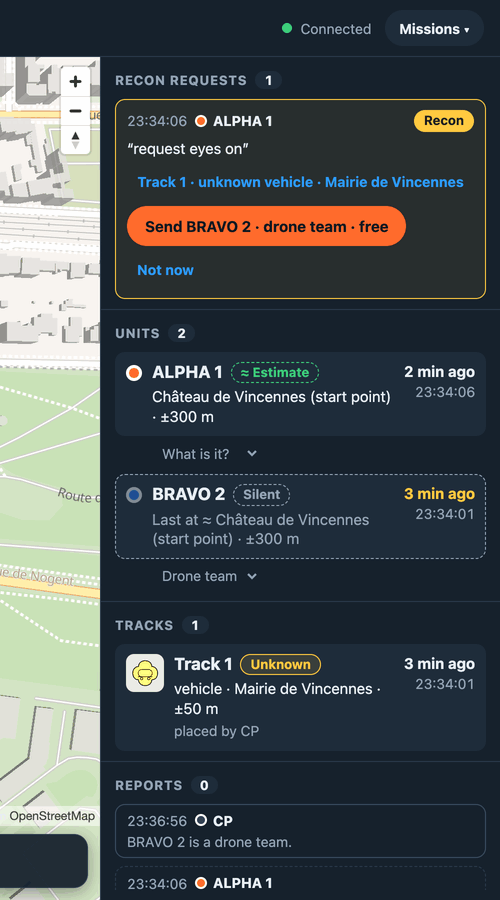

Checked on Saturday 21 November in mission `vincennes-3`, offline mode, with no model: Track 1 placed by hand, ALPHA 1's radio call "Track 1, request eyes on" typed, and BRAVO 2 joined at the château. Before BRAVO 2 was marked, sending it was refused; after, the tray offered it, the confirm read "Send BRAVO 2, drone team, to look at Track 1?", the line ran from the château to the town hall, and Recon done under BRAVO 2 ended it.

Each request, send, Recon done and decline is one line in the log (`request` and `task`, [contracts.md](contracts.md#session-log)), and so is each unit's kind (`unit`), so a replay shows the request open before the send and the line after it. A drone's marker does not move when it is sent: it stays where it was last reported or placed. Limits are in [known-gaps.md](known-gaps.md).

**The eval.** `npm run eval:requests`, also run by `npm test`: 84 cases in English, French, Ukrainian and Russian: requests with a report, requests on their own, with and without a track, turned down ("don't send the drone", «pas besoin de drone», «не треба дрона») and near misses ("enemy drone up north", "getting eyes on Track 2", "send BRAVO 2 to the station"). All 84 pass, and no request is read where none was said. 64 were written with the code. The other 20 were written by a separate agent from the rules alone, without the code, and scored before anyone looked at them: 20 of 20. That agent was told to keep to the words the rules list, so this checks the rules as written, not how soldiers actually ask; every case is typed, none is from speech-to-text.

The pictures: mission `vincennes-2`, Saturday 21 November, 22:38 to 22:40, on a coordinator of its own in offline mode (the 3B model), with typed reports. The drone team was placed by hand at the Lycée Claude-Nicolas Ledoux; ALPHA 1 checked in at Bérault and BRAVO 2 at the château, whose question the command post answered. Every sighting is made up.

## When symbols would overlap

The first run of the script, in mission `vincennes-13`, showed Track 1 drawn on top of ALPHA 1, Track 5 under BRAVO 2's dot, and the labels of Tracks 3 and 5 run together. The command post now lays the symbols out on screen [167]:

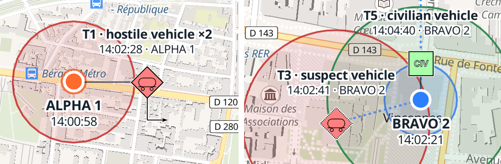

- **A symbol stays on its point** unless it would cover a unit's dot or label, or a track drawn before it. Then it is drawn at the nearest free spot, 40 pixels away or a multiple of that, with a thin dark line back to a small dot in the track's colour on the real point.
- **Only the drawing moves.** The track's place, its circle and its line of sight stay where the report put them. Units never move.
- **Older tracks keep their spot.** Tracks are laid out by number, so a new track moves, not one the operator already knows.
- **Again after every zoom,** because two places 100 m apart overlap at one zoom and not at the next. A symbol is not pushed off the map or under the replay bar, and a track out of sight is not moved.

Why Track 1's place was on ALPHA 1: a track on a street is placed at the street's point nearest the observer, with a circle of at least 150 m. That point stays, since the speaker did not say where along the street; only its symbol is drawn aside.

Limits: the size of a label is estimated from its number of letters, not measured. In a crowded spot a symbol can end up well away from its point, and its line can cross another label: Track 5 in the picture at the top.

## What moves on the map

Motion on the command post's map says one thing: this report is fresh, and the clock on screen is running. It never says where something is [238].

| What | When it moves | What it looks like |
|---|---|---|
| A track's heading arrow | The track has a heading, as said, and was seen in the last 10 minutes | Light bands run along the arrow from tail to tip. The arrow itself stays as it is |
| A unit's arrow to the place it is heading to | The unit was heard in the last 3 minutes | White dots run along the shaft to the arrowhead |
| A unit's dot or a track's symbol | A report gave it a new place | It slides there in 0.6 s, 0.3 s in a replay, instead of jumping |
| A track new on the map | Once, when it is first placed | One ring in its colour, twice, then nothing |

What does not move:

- **A track with no heading said.** Nothing was said about its movement, so nothing on it moves.
- **An old sighting.** When a track turns old it fades, says "not seen for", and its arrow stops: the way it was moving is what was said then, not what is known now.
- **The symbol itself, along its heading.** That would be a guessed position. A slide only runs between two places the log gave, and the new place is the truth from the first moment.
- **Anything, when the clock on screen does not run:** an ended mission and a paused replay are one moment, held. Nothing slides after a jump either: a drag along the replay bar, another mission, live to replay.
- **Anything, when the computer is set to reduce motion.**

The flow's speed is fixed and means nothing: the app knows no speed. Nothing blinks, and no symbol changes shape or colour. The standard symbols draw movement with still marks, so the still arrow of [197] stays and reads the same in a screenshot. The rules are in `components/motion.ts`, with tests in `tests/motion.test.ts`.

## Taking the pictures again

Retake them when the command post or the phone screens change.

1. Run the coordinator on port 3117 and open a new mission with no start point.
2. In the iPhone simulator, join it as ALPHA 1, pick "Vincennes with tracks (made up)" and tap ALPHA 1's steps in order. Send BRAVO 2's steps as typed reports to `POST /api/report` (text, session, call sign BRAVO 2, language). Tap **Cimetière Nord de Saint-Mandé** when the phone asks. For the command post pictures alone, ALPHA 1's steps can be typed too, with the choice sent to `POST /api/answer`.
3. Phone screens: `xcrun simctl io booted screenshot <file>.png`, then 420 px wide.
4. Command post: headless Chrome at 1440 × 900 and 2× pixel density, after about 8 s for the map. The full pictures are reduced to 1600 px wide; the close-ups are cut from the full size. All are reduced to at most 256 colours, without dithering, so each stays under 600 KB: the two full pictures needed 240. The close-ups: the list scrolled to its end; the estimate after clicking Track 2 in the list and zooming out once; the two halves of the overlap picture from the question picture and after clicking BRAVO 2.
5. Placed by hand, after the script: press P, pick Hostile, People, 2 and ±50 m, click the map and type a source, for the palette picture. Then Place, Esc, and click the new track for its card.
6. The symbol table: one SVG made with milsymbol from `trackSymbolCode`, every affiliation against every kind, size 26.
7. Recon: a new mission with ALPHA 1 and BRAVO 2 on the roster. Place a friendly drone team, check both units in, then send "ALPHA 1, unknown vehicle at Mairie de Vincennes, send the drone" as a typed report. The tray picture is two close-ups, 800 × 470 from the 2× picture, set side by side: before and after clicking the drone's button. Send from the confirm, wait two minutes for the note about other missions to go, and take the full picture.
