# Tracks

A track is something on the map that is not a reporting unit: a vehicle, people, a drone, a team. A unit reports it by voice, the coordinator gives it a number, and the receiver draws it with its standard symbol. Tracks are for reconnaissance only [145]: the app marks what was seen and asks when a report is unclear. It never works out anything between a unit and a track.

Built on Saturday 21 November, steps 1 to 3 of five ([plan](plan.md#tracks-what-a-unit-sees)). The rules are in the [README](../README.md#tracks), the fields in [contracts.md](contracts.md#tracks), and the choices in DECISIONS.md [145 to 157, 160, 167]. This page shows what it looks like and how a report becomes a track.

## The pictures

All the pictures come from one run of the tracks script ([README](../README.md#vincennes-with-tracks)) on Saturday 21 November, 10:40 to 10:43, in mission `vincennes-15`. The coordinator ran on the Mac in hosted mode (Mistral). ALPHA 1 was the transmitter in the iPhone 16 Pro simulator, playing the script's clips; BRAVO 2's reports were typed. Every sighting is made up.

### The receiver at the end of the script

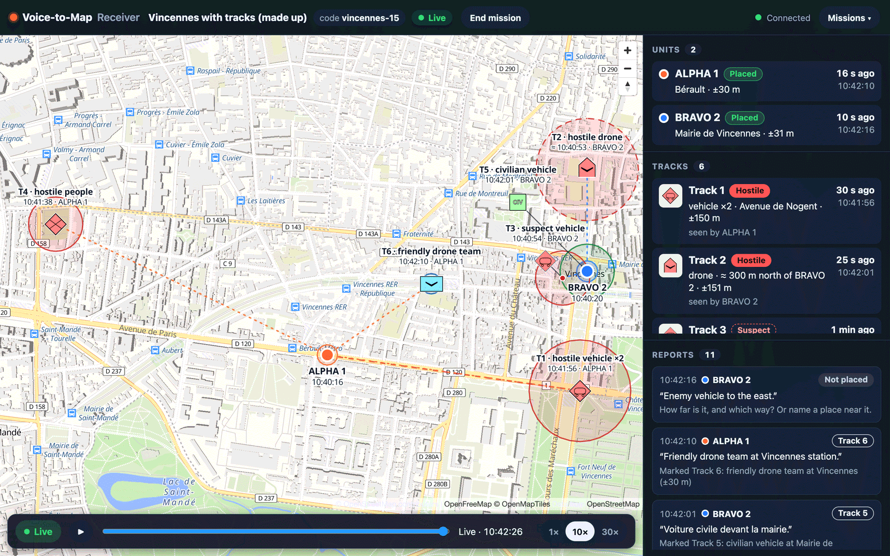

- **Units are dots, tracks are symbols.** ALPHA 1 (orange) and BRAVO 2 (blue) never moved: a report about a track does not move the speaker.
- **Each track has a label:** number, what it is, the time it was last seen and who saw it ("T1 · hostile vehicle ×2, 10:41:56 · ALPHA 1").
- **A symbol that would hide a unit or another track is drawn a short way off,** with a thin line back to a small dot on its real point ([below](#when-symbols-would-overlap)). Track 5, a civilian car at the town hall where BRAVO 2 stands, is drawn above and to the left; Track 3 is drawn beside the church.
- **A dotted line of sight** runs from the observer to each track it reported: ALPHA 1 to Tracks 4 and 6, BRAVO 2 to Track 2.
- **A dashed trail** shows where a track was before. Track 1 was first seen on Avenue de Paris and moved to Avenue de Nogent.
- **The circle** is how sure the place is. A track on a street gets at least 150 m, because the speaker did not say where along it.
- **A dashed circle and ≈** mean an estimate. Track 2 was placed 300 m north of BRAVO 2, then marked hostile without moving.
- **The list** gives each track its symbol, a word for whose it is, what and where, and who saw it. The last two tracks:

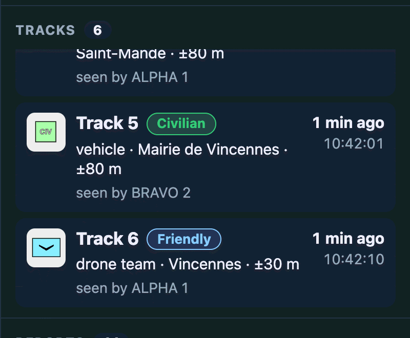

### While a question is open

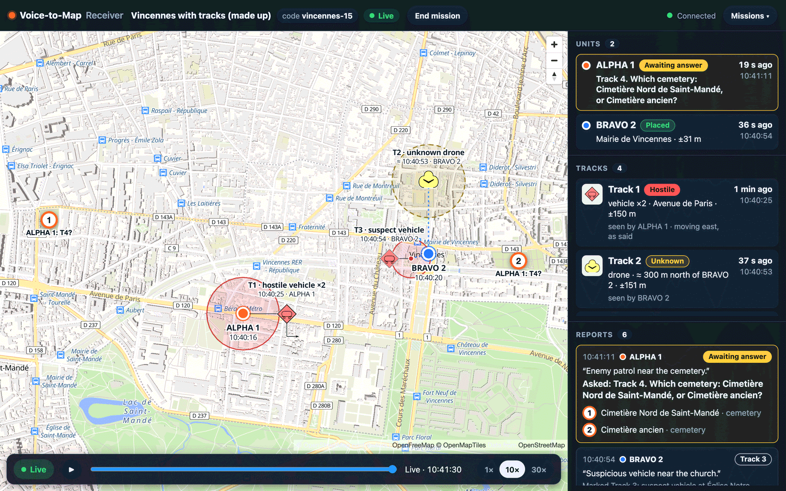

"Enemy patrol near the cemetery" could mean two cemeteries, so the app asked. ALPHA 1 shows "Awaiting answer", the question is in the unit list and the feed, and the two choices are numbered on the map ("ALPHA 1: T4?"). Track 4 already has its number but no place until the choice is tapped.

Note Track 1 at this point. Its place is on ALPHA 1's dot, because Bérault is on Avenue de Paris, so its symbol is drawn just east of ALPHA 1 with a line back ([below](#when-symbols-would-overlap)).

### An estimate

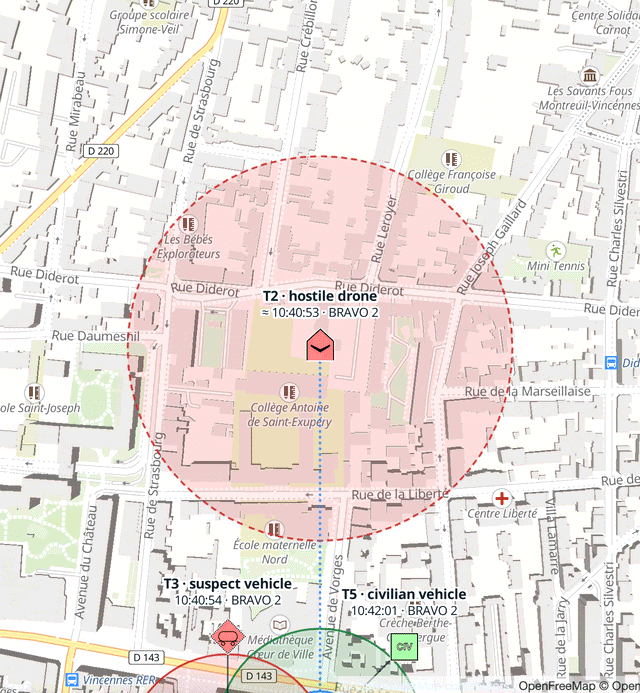

"I see a drone about 300 metres north of me" gives no place, only a distance and a direction. The track is worked out from BRAVO 2's position, so its circle is BRAVO 2's own plus 0.4 × the distance, dashed, and its time starts with ≈.

### On the phone

| Track 1 said back | The question for Track 4 | After the answer |
|---|---|---|
| 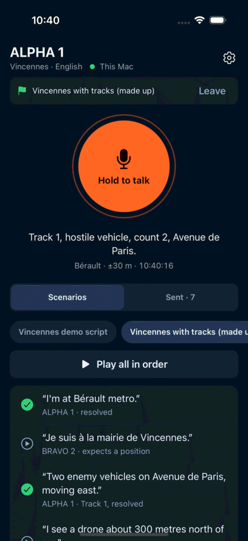 | 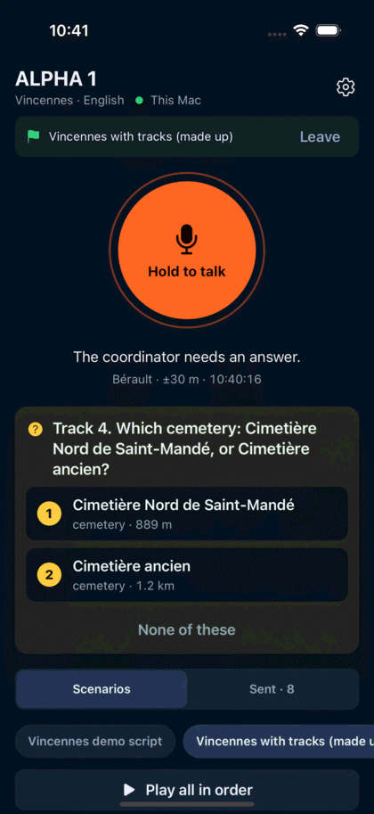 | 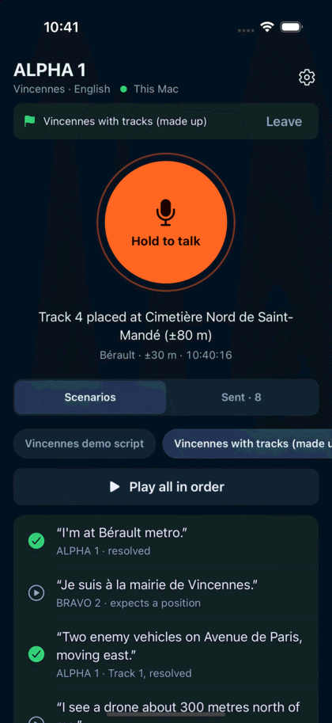 |

| A friendly track | The scenario list |
|---|---|
| 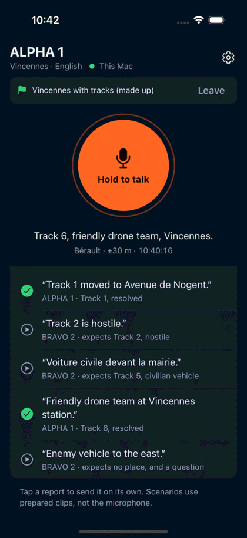 | 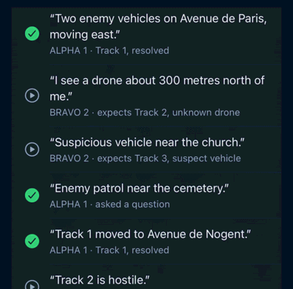 |

The phone says the number back aloud and on screen. The line under it is still the speaker's own position, "Bérault · ±30 m", after every report about a track. A question about a track starts with its number, and the distances are measured from the speaker. Once a choice is tapped, the phone says the number again with the place: "Track 4 placed at Cimetière Nord de Saint-Mandé (±80 m)". In the scenario list a step about a track says which track it expects ("expects Track 3, suspect vehicle") and is marked "Track 1, resolved" when it passes. In the first run, in mission `vincennes-13`, the coordinator took 1.1 to 1.6 s for each of ALPHA 1's clips, speech to text included.

## Symbols

The frame says whose a track is, the icon what it is. These are the APP-6 symbols (MIL-STD-2525C letter codes) from `trackSymbolCode` in `lib/geo/trackKinds.ts`, drawn by milsymbol 3.0.5, as on the receiver.

| Whose | Frame | Set by these words | Pill |
|---|---|---|---|
| Hostile | red diamond | "enemy", "hostile", «ennemi», «ворожий» | red |
| Suspect | red diamond, dashed | "suspicious", "possible enemy" | red, dashed |
| Unknown | yellow clover | nothing said: the default | yellow |
| Civilian | green square | "civilian", «civil» | green |
| Friendly | blue rectangle, a circle for a vehicle | "our", "friendly" | blue |

A civilian thing never gets a military icon: a civilian vehicle has its own symbol, anything else an empty frame. The model only picks a kind from the fixed list. It never picks a code, and it never decides whose a track is: that comes from the words [148, 151]. A drone, being in the air, gets the air frame, open at the bottom.

## How a report becomes a track

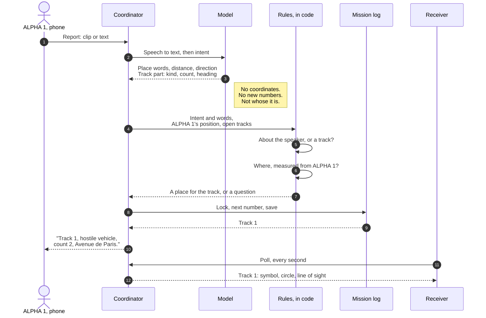

The model is Mistral in hosted mode or the 3B model on the laptop in local mode. It reads a number when one is said ("Track 3 moved …"), but only the coordinator gives new ones. The rules never return a new position for the speaker.

The number is given inside the mission's lock, so two phones reporting at once never get the same one. Numbers count up per mission and are never reused. A number carries no affiliation, so Track 2 keeps its number when it turns from unknown to hostile.

## About the speaker, or something seen?

The model reads every report as about the speaker or about a track. Code then checks that reading against the words, and asks when they disagree.

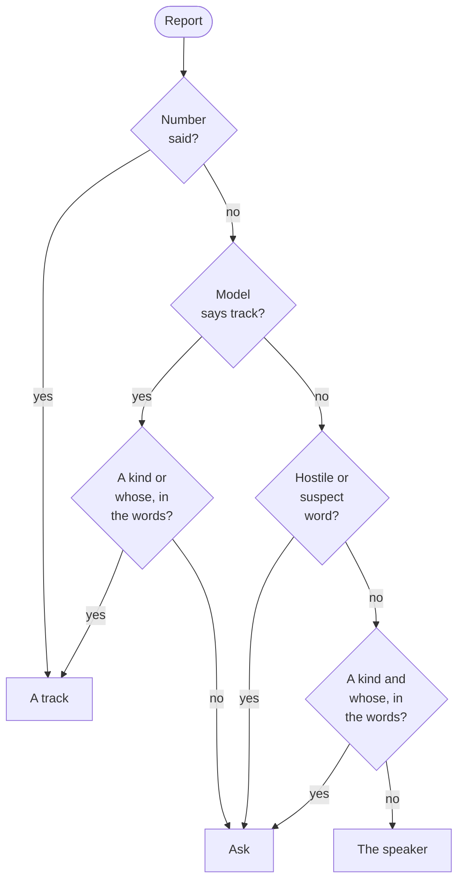

| Said | Model reads | Result |
|---|---|---|
| "Track 3 moved to the station." | anything | a track |
| "Enemy vehicle in front of the town hall." | a track | a track |
| "I can see the church." | a track | asks: no word names a thing |
| "Enemy at the station." | the speaker | asks: a hostile word was said |
| "Our drone team is at the station." | the speaker | asks: a thing and whose it is were named |
| "I'm at the station." | the speaker | the speaker, placed as before tracks |
| "Friendly at the station." | a track | a track [175]; read as the speaker, it would move the unit, since a friendly word alone is not checked |

The question is "Is that where you are, or something you see? Say 'I am at' or 'I see'." The last check was added with the script [157]: hosted Mistral read "Our drone team is at Vincennes station" as the speaker's own position and moved the unit.

## Where the track goes

| Said | Ends at | The app says |
|---|---|---|
| "Track 9 is hostile." (there is no Track 9) | No such track | "There is no Track 9 in this mission." |
| "Track 2 is hostile." | Update what it is | "Track 2, hostile." |
| "Enemy vehicle." | Ask where | "Where is it? Name a place near it, or a distance and a compass direction from you." |
| "Vehicle heading towards the bridge." | Ask where | the same |
| "Suspicious vehicle near the church." | Placed | "Track 3, suspect vehicle, Église Notre-Dame." The nearest church to the observer |
| "Enemy patrol near the cemetery." | Ask which | "Track 4. Which cemetery: Cimetière Nord de Saint-Mandé, or Cimetière ancien?" |
| "I see a drone about 300 metres north of me." | Placed, ≈ | "Track 2, unknown drone, 300 metres north of you." |
| The same, from a unit with no position yet | Ask for a place | "I don't know where you are. Name a place near what you see." |
| "Enemy vehicle to the east." | Ask how far | "How far is it, and which way? Or name a place near it." |

A track on a street or along a river gets a circle of at least 150 m. "Track 1 moved to Avenue de Nogent" is read as "at Avenue de Nogent": the model often reads "moved to" as "towards", so only a word such as "heading" or "on its way" makes it a direction [149]. A compass word said with a place, as in "moving east", is the way the track was moving, not where it is.

## A track's life

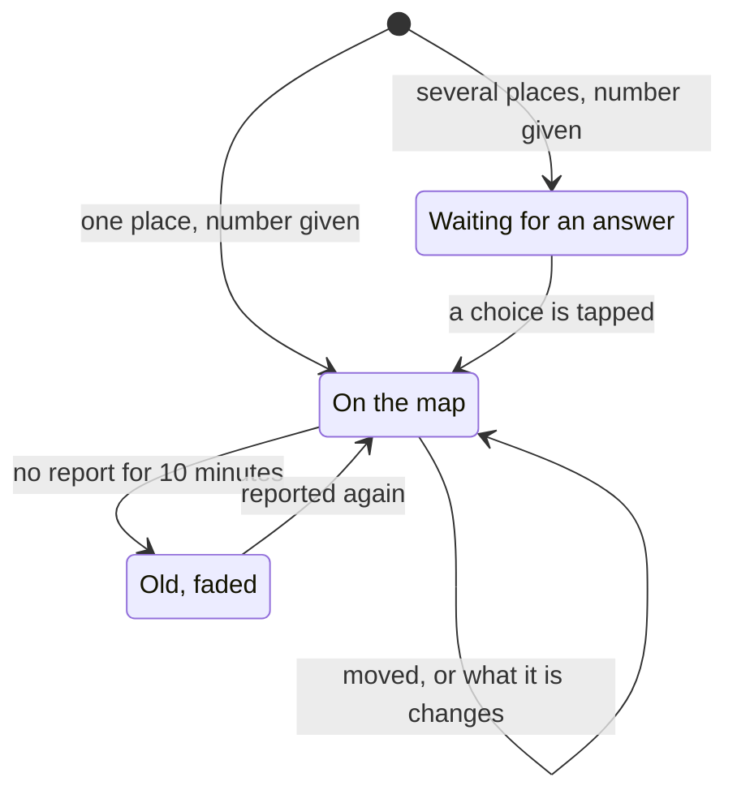

A move adds the old place to the track's trail. A change of whose it is or what it is keeps its place, its number and its trail. Not built yet: "Track 3 is gone", and a question when a new sighting is close to an old track ("Is this Track 3, or a new one?"). Until then every sighting without a number opens a new track.

## When symbols would overlap

The first run of the script, in mission `vincennes-13`, showed Track 1 drawn on top of ALPHA 1, Track 5 under BRAVO 2's dot, and the labels of Tracks 3 and 5 run together. The receiver now lays the symbols out on screen [167]:

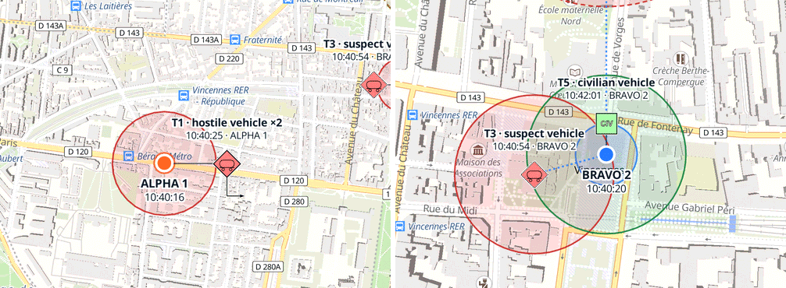

- **A symbol stays on its point** unless it would cover a unit's dot or label, or a track drawn before it. Then it is drawn at the nearest free spot, 40 pixels away or a multiple of that, with a thin dark line back to a small dot in the track's colour on the real point.
- **Only the drawing moves.** The track's place, its circle and its line of sight stay where the report put them. Units never move.
- **Older tracks keep their spot.** Tracks are laid out by number, so a new track moves, not one the operator already knows.
- **Again after every zoom,** because two places 100 m apart overlap at one zoom and not at the next. A symbol is not pushed off the map or under the replay bar, and a track out of sight is not moved.

Why Track 1's place was on ALPHA 1: a track on a street is placed at the street's point nearest the observer, with a circle of at least 150 m. That point stays, since the speaker did not say where along the street; only its symbol is drawn aside.

Limits: the size of a label is estimated from its number of letters, not measured. In a crowded spot a symbol can end up well away from its point, and its line can cross another label: Track 5 in the picture at the top.

## Taking the pictures again

Retake them when the receiver or the phone screens change.

1. Run the coordinator on port 3117 and open a new mission with no start point.
2. In the iPhone simulator, join it as ALPHA 1, pick "Vincennes with tracks (made up)" and tap ALPHA 1's steps in order. Send BRAVO 2's steps as typed reports to `POST /api/report` (text, session, call sign BRAVO 2, language). Tap **Cimetière Nord de Saint-Mandé** when the phone asks.
3. Phone screens: `xcrun simctl io booted screenshot <file>.png`, then 420 px wide.
4. Receiver: headless Chrome at 1440 × 900 and 2× pixel density, after about 8 s for the map. Reduced to 1600 px wide and 256 colours, so each picture stays under 600 KB. The close-ups: the estimate after clicking Track 2 in the list; the two halves of the overlap picture from the question picture and after clicking BRAVO 2.
5. The symbol table: one SVG made with milsymbol from `trackSymbolCode`, every affiliation against every kind, size 26.
